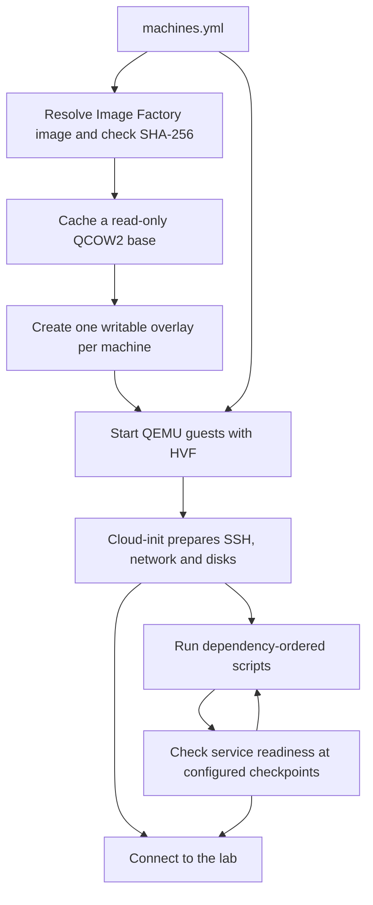

# Labstack

[](https://github.com/cdelgehier/labstack/actions/workflows/test.yml)


Labstack is a personal lab tool for macOS on Apple Silicon.
It runs Linux ARM64 virtual machines with QEMU and HVF, using a YAML inventory
and ordered provisioning scripts.

Build labs for CKAD, CKA and CKS practice, or use the same VMs for Argo CD,
Crossplane and local tests. These labs often require installing system packages,
changing systemd services and units, or adjusting kernel settings with sysctl.
The VMs provide a full Linux system with sudo access for these exercises.

The included recipe installs Kubernetes **1.37.1** with Cilium on one control plane
and one worker. A second worker is optional.

## Quick Start

Install [Homebrew](https://brew.sh), then clone the project and install Task:

```sh
git clone https://github.com/cdelgehier/labstack.git
cd labstack
brew install go-task
task prerequisites
task up
task connect -- cp
```

`task prerequisites` installs the required tools, Python 3.15 and the locked
project dependencies. `task connect -- cp` opens an SSH shell with the machine's
`ssh_user`, which is `ubuntu` in the included inventory.
Run your Kubernetes commands from that shell.
Use the machine key from `machines.yml` after `--`, for example
`task connect -- w1`. Use `task status` to list the active machines.

To use your Mac's kubectl, export the cluster configuration:

```sh
task kubeconfig
kubectl --kubeconfig ./kubeconfig get ns
```

The file uses the API port published on localhost and keeps TLS verification enabled.
It stays in the project directory; your `~/.kube/config` is unchanged.

To practice installing Kubernetes yourself, start clean Ubuntu nodes:

```sh
task up:no-provision
task connect -- cp
```

This prepares access, networking and disks while skipping the provisioning
scripts and healthchecks. Use it with a new environment; it does not remove installed software.

Documentation index: [docs/README.md](docs/README.md).

Machine configuration and script recipes: [docs/configuration.md](docs/configuration.md).

Daily commands and manual installation: [docs/usage.md](docs/usage.md).

Useful checks:

```sh
task ci
task test:runtime
```

`task ci` checks code and configuration without starting VMs.
`task test:runtime` checks the running lab.

## Lab Configuration

Edit [machines.yml](machines.yml) to choose resources, images, networks,
published ports and scripts. The machine key supplies its hostname, SSH name and
disk directory. This example shows the control plane resources and script list:

```yaml
machines:
  cp:
    box: ubuntu-26.04-arm64
    ssh_user: ubuntu
    cpus: 2
    memory_mib: 2048
    disk_gib: 20
    networks:
      nat: {}
      lab: {ipv4_address: 192.168.76.10}
    ports: ["52222:22", "16443:6443"]
    scripts:
      - provision/base/packages.sh
      - provision/kubernetes/prepare.sh
      - provision/kubernetes/control-plane.sh
      - provision/kubernetes/cilium.sh
      - provision/kubernetes/addons.sh
```

Image names resolve through the [Image Factory catalogue](https://cdelgehier.github.io/image-factory/).
Labstack selects the latest stable image when creating the lab, checks its
archive and disk checksums, and saves the version for later starts.
Use `box: ubuntu-26.04-arm64:0.4.0` to request an exact version.
Set `ssh_user` to the image's account, such as `ubuntu`, `debian` or `vagrant`.
Cloud-init gives that account the lab's SSH key and passwordless sudo.

Each machine chooses its own ordered `scripts` list. Add scripts for another
workload under `provision/` and replace that list.
The default lab starts `cp` and `w1`. For a new lab with a second worker, run:

```sh
task up PROFILES=extra-worker
```

Machines without a profile always start. Root `x-*` blocks share default values
through YAML anchors. Each machine can override them by setting its own fields.
`healthcheck` checks guest services, and `depends_on` gates scripts
on those results. The included recipe waits for the API before worker joins and
for worker setup before Cilium. See [configuration](docs/configuration.md) for the
complete examples and dependency conditions.

For a complete example with every VM written out, see the
[inventory without YAML anchors](docs/explicit-inventory.md).

## Runtime Flow



The default lab uses 3.5 GiB of guest memory and 20 GiB of virtual disk capacity
per node. Only written disk data takes space on the Mac. Published ports bind
to `127.0.0.1`; private guest traffic uses a QEMU socket network.

`task down` stops the VMs and keeps their disks.

`task destroy` removes the lab
and its access keys while keeping the image cache and diagnostic logs.
Application progress goes to stderr; captured output uses JSON logs.

Package layout, settings, logging and contributor checks:
[docs/development.md](docs/development.md).
