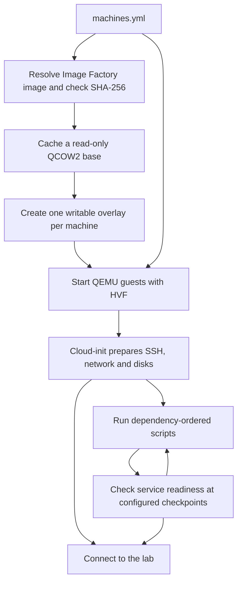

# Labstack

[](https://github.com/cdelgehier/labstack/actions/workflows/test.yml)


Labstack creates and manages local Linux ARM64 virtual machines on macOS with
Apple Silicon. It uses QEMU with HVF acceleration, a YAML inventory and shell
scripts to provision each guest.

The inventory defines machine resources, images, networks, published ports and
startup dependencies. Each lab supplies the scripts that install its software.

Labstack manages:

- Image downloads, checksum verification and a shared read-only disk cache.
- Per-machine writable disks, SSH access and cloud-init configuration.
- Private guest networking and ports published on the Mac's localhost.
- Ordered provisioning scripts, readiness checks and dependencies between VMs.
- Starting, stopping, recreating and removing an environment while keeping its
  saved image versions and configuration.

## Quick Start

Install [Homebrew](https://brew.sh), then clone the project and install Task:

```sh
git clone https://github.com/cdelgehier/labstack.git
cd labstack
brew install go-task
task prerequisites
```

`task prerequisites` installs the host tools, Python and the locked project
dependencies.

For a first lab, replace the contents of [machines.yml](machines.yml) with this
single-VM example. If an environment already exists, run `task destroy` before
changing its inventory; this removes its VM disks and access keys.

```yaml
boxes_catalogue: https://cdelgehier.github.io/image-factory/

machines:
  node:
    box: ubuntu-26.04-arm64
    ssh_user: ubuntu
    cpus: 2
    memory_mib: 2048
    disk_gib: 20
    networks:
      nat: {}
      lab:
        ipv4_address: 192.168.76.10
    ports:
      - "52222:22" # SSH
    scripts:
      - provision/base/packages.sh # Common guest tools

networks:
  nat:
    driver: nat
  lab:
    driver: socket
    subnet: 192.168.76.0/24
```

Start the VM and open a guest shell:

```sh
task up
task status
task connect -- node
```

The machine key supplies its hostname, SSH name and disk directory. Use the
name from your inventory after `--`. Guest access uses its configured
`ssh_user`; cloud-init installs the lab's SSH key and passwordless sudo.

## Configure and provision machines

Image names resolve through the
[Image Factory catalogue](https://cdelgehier.github.io/image-factory/).
Labstack selects the latest stable image when creating the environment, verifies
its archive and disk checksums, and saves the selected release for later starts.
A reference such as `ubuntu-26.04-arm64:0.4.0` requests an exact version.

Each machine has its own ordered `scripts` list. Add shell scripts under
`provision/` and reference them in the inventory. They run as root through SSH.
An adjacent `assets/` directory can hold configuration files or application
sources; Labstack transfers them before running the script and sets
`PROVISION_ASSETS_DIR` to their guest location.

Use `environment` and `env_file` for guest variables. `healthcheck` defines a
readiness command, and `depends_on` makes a machine wait for another at a chosen
provisioning step. Profiles select optional machines. YAML anchors and root
`x-*` blocks can share settings between machines.

See the [configuration reference](docs/configuration.md) and
[guest environment guide](docs/environment.md) for the available fields,
examples and validation rules.

## Daily commands

| Command | Result |
| --- | --- |
| `task up` | Create or resume the environment and run its provisioning scripts |
| `task up:no-provision` | Create or resume VMs without running scripts or healthchecks |
| `task status` | List the saved machines and their state |
| `task connect -- node` | Open an SSH shell by machine name |
| `task down` | Stop the VMs and keep their disks |
| `task reset` | Recreate the saved environment with the same image versions |
| `task destroy` | Remove VMs and access keys; keep cached images and logs |
| `task images:prune:dry-run` | List unused project-cached base images |
| `task images:prune` | Remove unused project-cached base images |

Provisioning scripts should be safe to run again: `task up` reruns them on an
existing environment. `task up:no-provision` keeps already installed software.
Reset preserves the provisioning choice recorded in the saved state.

See the [usage guide](docs/usage.md) for inventory selection, lifecycle details,
file transfers, disk paths and local image overrides.

## Runtime Flow



Only written disk data takes space on the Mac. Published ports bind to
`127.0.0.1`; private guest traffic uses a QEMU socket network.

Machine disks, access keys and saved state stay under `.state/`. Images are
cached in `.cache/`, and diagnostic output stays in `logs/`. Progress goes to
stderr; captured application events use JSON logs.

## Documentation and development

Start with the [documentation index](docs/README.md) for configuration and
operating guides. The [development guide](docs/development.md) covers the Python
package, settings, logging and contributor checks.

```sh
task ci
task test:runtime
```

`task ci` checks code and configuration without starting VMs.
`task test:runtime` checks the running environment.

## Example labs

The repository also contains two separate lab recipes, each with its own
inventory, provisioning scripts and instructions:

- [CKS practice lab](provision/kubernetes/README.md).
- [HolmesGPT demo lab](provision/holmesGPT/README.md).

See the [example lab guide](docs/recipes.md) to select or save an inventory.
