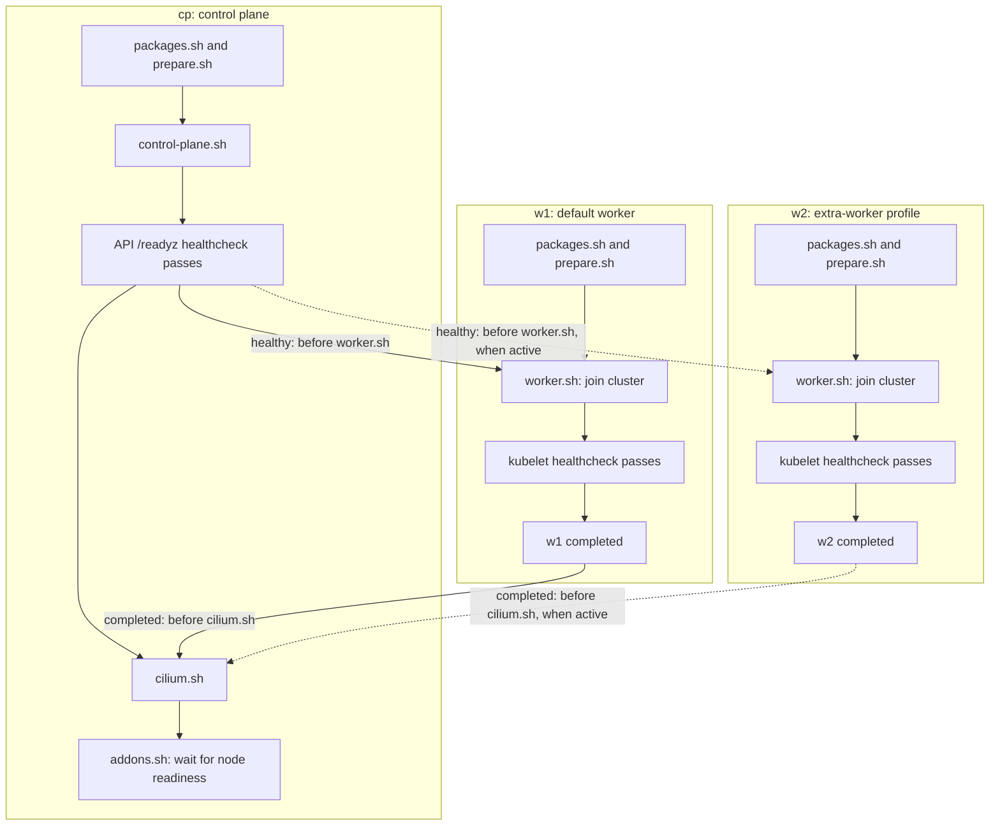

# Configure your lab

Run commands from the project directory.

## Machine configuration

Edit [machines.yml](../machines.yml) to set each guest's resources, image,
network, scripts and readiness checks. Machine keys are their names:

```yaml
boxes_catalogue: https://cdelgehier.github.io/image-factory/

machines:
  cp:
    box: ubuntu-26.04-arm64
    # Add resources, networks, ports and scripts as shown in machines.yml.
  w1:
    box: ubuntu-26.04-arm64
```

For a complete example with every machine written out, use the
[inventory without YAML anchors](explicit-inventory.md). It has the same settings
as the included recipe, with shared values repeated under each VM.

| Field | Meaning |
| --- | --- |
| Machine key, such as `cp` | Guest hostname, SSH name and disk directory |
| `cpus` | Number of virtual CPUs |
| `memory_mib` | Memory in MiB |
| `disk_gib` | Disk capacity in GiB, with a minimum of 16 |
| `box` | Image Factory target name, with an optional `:X.Y.Z` version |
| `profiles` | Optional groups that can enable this machine |
| `networks` | Named networks and the machine's private IPv4 address |
| `ports` | TCP ports published on the Mac, in `HOST:GUEST` format |
| `scripts` | Ordered shell script paths, relative to the project directory |
| `healthcheck` | Guest command and retry settings for startup readiness |
| `depends_on` | Dependencies that gate the first script or a chosen script |

The inventory accepts one to sixteen machine definitions. It validates inactive
machines too, including addresses, ports and dependency references. Unknown fields
and duplicate explicit YAML keys are errors.

## Select profiles

Machines without `profiles` always start. A profiled machine starts when at least
one of its groups is enabled. The included `w2` has `profiles: [extra-worker]`:

```sh
task up                            # cp and w1
task up PROFILES=extra-worker      # cp, w1 and w2, for a new lab
```

You can set the default groups at the root with `profiles: [extra-worker]`.
`PROFILES=extra-worker,monitoring` selects multiple defined groups. Unknown names
fail validation. Dependencies do not enable profiles automatically; a required
inactive dependency is an error. Use `required: false` for an optional machine.

The selected groups are saved with the lab. Later `task up` and `task reset` keep
that selection even when `PROFILES` is omitted. Use `task destroy` before changing
profiles, machine order, resources, networks or provisioning settings.

## Reuse YAML blocks

This is optional. You can write the fields directly under each machine, as shown
in the [explicit inventory example](explicit-inventory.md).

Root keys starting with `x-` hold reusable default values. A machine imports
those defaults with `<<: *anchor_name` and can override any field by writing it
directly in its own block. YAML expands the anchors before Labstack validates
the inventory; the reusable blocks themselves do not create VMs:

```yaml
x-ubuntu: &ubuntu
  box: ubuntu-26.04-arm64
  cpus: 1
  memory_mib: 1536
  disk_gib: 20

x-worker-scripts: &worker_scripts
  - provision/base/packages.sh
  - provision/kubernetes/prepare.sh
  - provision/kubernetes/worker.sh

machines:
  cp:
    <<: *ubuntu
    cpus: 2
    memory_mib: 2048
    # Add this machine's networks, ports and scripts.
  w1:
    <<: *ubuntu
    scripts: *worker_scripts
    # Add this machine's networks and ports.
  w2:
    <<: *ubuntu
    profiles: [extra-worker]
    scripts: *worker_scripts
    # Add distinct private addresses and published ports.
```

In this example, `cp` inherits `box` and `disk_gib` from `x-ubuntu`. Its own
`cpus: 2` and `memory_mib: 2048` override the defaults of 1 CPU and 1536 MiB.
The shared defaults stay unchanged: `w1` and `w2` still use 1 CPU and 1536 MiB.
An inherited value and an explicit override are valid; writing the same key
twice directly in one block is an error.

YAML merges mappings, not lists; an explicit `scripts` list replaces the shared
list. Edits to an `x-*` block matter when its values are referenced by a machine.

## Choose images

An unversioned name selects the highest published stable version when the environment
is created. Preview versions are skipped. Use `box: ubuntu-26.04-arm64:0.4.0` to select
an exact version instead. A missing version stops startup with a clear error.
The catalogue must offer the `qemu` provider for `arm64`. Its box uses the `libvirt`
archive format; the runner extracts the QCOW2 disk directly.

The chosen release, URL and checksums are saved in `.state/state.json` for each active
machine. Restarts and `task reset` reuse that image without reading the catalogue again.
They also verify the cached disk against its saved checksum. To select a newer image,
run `task destroy` and then `task up`. The first start needs network access for metadata,
even when the disk is already cached. Machines sharing one box name use one resolution
and one cached base disk.
The current provisioning requires an Image Factory Ubuntu 26.04 ARM64 image with the `ubuntu` account.

Each machine references the networks declared at the bottom of the file:

```yaml
machines:
  cp:
    # Image, resources and scripts are omitted from this network example.
    networks:
      nat: {}
      lab:
        ipv4_address: 192.168.76.10
    ports:
      - "52222:22"
      - "16443:6443"

networks:
  nat:
    driver: nat
  lab:
    driver: socket
    subnet: 192.168.76.0/24
```

The structure uses ideas from Docker Compose. The runner translates it into QEMU
arguments and cloud-init files. QEMU starts the VMs, then SSH runs their scripts.
Network names are your choice; each machine must reference both defined networks.
The supported topology has one `nat` network and one `socket` network.

`driver: nat` gives each guest DHCP, Internet access and published ports through
QEMU user networking. `driver: socket` connects the guests to a private QEMU hub.
The subnet is defined once, and each machine selects a unique host address in it.
It must be a private IPv4 subnet. MAC addresses and guest interface settings are generated.

`"52222:22"` publishes the guest's SSH port 22 as port 52222 on the Mac.
`"16443:6443"` publishes the Kubernetes API. Every mapping binds to `127.0.0.1`
and uses TCP. Host ports must be unique and between 1024 and 65535; guest ports
must be between 1 and 65535. Each machine needs exactly one mapping for SSH port 22.
The Kubernetes control plane also needs a mapping for guest port 6443.
Add mappings such as `"18080:8080"` to reach other guest services.
Do not add an IP address, protocol suffix or port range to a mapping.

Active machines start in file order. The first active machine hosts the QEMU network hub.
The Kubernetes control plane is the active machine whose scripts include
`provision/kubernetes/control-plane.sh`. It can appear anywhere in the file;
its position does not change API access, worker joins or Kubernetes checks.
Select only one control plane for this recipe.
Inactive definitions keep their index, so profile selection does not renumber other guests' MAC addresses.
Connection commands use the exact machine names saved when the lab was created.
For a machine named `monitoring`, use `task connect -- monitoring`.
Use `task status` to list active machines. For the optional second worker,
create a lab with `PROFILES=extra-worker`.
Names, resources, image pins and the expanded inventory are saved with the environment.
Provisioning is chosen by the task command: `task up:no-provision` skips all scripts
and healthchecks while preparing SSH, cloud-init, networking and disks.

## Choose the provisioning scripts

The `scripts` list decides what is installed on each machine. There is no `role` field.
The default control plane uses:

```yaml
scripts:
  - provision/base/packages.sh
  - provision/kubernetes/prepare.sh
  - provision/kubernetes/control-plane.sh
  - provision/kubernetes/cilium.sh
  - provision/kubernetes/addons.sh
```

The `x-kubernetes-worker` block shares worker resources, scripts, dependencies
and healthchecks. Each worker supplies its own network address and host ports.

Scripts keep their order within each guest. Work that is ready runs in batches,
in YAML machine order. With no cross-machine dependency, this keeps the usual
rounds: all first scripts run, then all second scripts, and so on. Dependencies
can delay a script until a server with a longer list has reached the needed state.

Keep scripts grouped by purpose:

```text
provision/
  base/
    packages.sh
  kubernetes/
    prepare.sh
    control-plane.sh
    worker.sh
    cilium.sh
    addons.sh
```

`base/packages.sh` only installs common tools such as curl, jq, rsync and vim.
The Kubernetes directory contains the kernel, containerd, kubeadm and addon setup.
For another workload, add scripts under `provision/nomad/`, `provision/monitoring/`
or another suitable directory, then replace each machine's list.
Use `scripts: []` for a machine
that needs no additional setup, or select only `provision/base/packages.sh` for common tools.
Removing the Kubernetes control plane script also disables the automatic Kubernetes
status, kubeconfig export and runtime checks. The VM and network setup stays the same.

Scripts run as root through SSH. They receive these environment variables:

| Variable | Meaning |
| --- | --- |
| `NODE_NAME` | Current machine's name |
| `NODE_IP` | Current machine's private IPv4 address |
| `PRIMARY_NODE_IP` | Kubernetes control plane's private IPv4 address; first machine's address for other recipes |
| `NODE_COUNT` | Number of active machines |
| `KUBERNETES_VERSION` | Pinned version, currently `1.37.1` |
| `SHARED_DIR` | Private guest directory for files needed by later scripts |

Files written to `SHARED_DIR` are copied to `.state/shared/` after a successful script
and sent to the next guest before its script starts. The Kubernetes recipe uses this
for a join token with a 30-minute lifetime. Directories have mode `0700` and files `0600`.
Keep secrets out of script output and do not enable shell tracing.
These files stay private and are removed with the environment by `task destroy`.

Script paths must point to existing `.sh` files under `provision/`.
The active lists are checked before creating the environment.
A failed script stops provisioning and keeps the VM disks and logs.
`task up` runs the lists again when resuming, so scripts must be safe to run more than once.


## Check health and order dependencies

A healthcheck runs inside the guest through SSH. A zero exit status means ready.
For the control plane, check its API after initialization:

```yaml
healthcheck:
  test: [CMD, sudo, kubectl, --kubeconfig=/etc/kubernetes/admin.conf, get, --raw=/readyz]
  after: provision/kubernetes/control-plane.sh
  interval: 5s
  timeout: 10s
  retries: 24
```

`after` names an exact path in that machine's `scripts`. Later scripts wait for
this check to pass. With no `after`, the check runs after the last script, or
immediately after cloud-init when the guest has no scripts.

| Field | Default | Meaning |
| --- | --- | --- |
| `test` | Required | `[CMD, command, arguments...]`, `[CMD-SHELL, "shell command"]`, or a shell string |
| `after` | End of the script list | Script checkpoint after which to run the check |
| `interval` | `5s` | Delay between failed attempts |
| `timeout` | `10s` | Maximum time for one command attempt |
| `retries` | `12` | Maximum number of attempts |
| `start_period` | `0` | Initial delay before the first attempt |

Durations accept seconds as numbers, or strings such as `500ms`, `5s` and `2m`.
Use `CMD` when arguments must stay literal. Use `CMD-SHELL` or a string for shell
operators such as pipes. Output stays in `logs/<machine>-healthcheck.log`.
Checks run during provisioned startup; they do not monitor guests in the background.
They run again with `task up`. `task up:no-provision` skips them.

A worker needs the API before its join script, but can install packages first:

```yaml
depends_on:
  cp:
    condition: healthy
    before: provision/kubernetes/worker.sh
```

| Condition | Requirement |
| --- | --- |
| `started` (default) | Dependency has passed SSH and cloud-init checks |
| `healthy` | Dependency's configured healthcheck has passed |
| `completed` | Dependency's full script list and healthcheck have succeeded |

Without `before`, the first script waits. A guest without scripts waits before
its healthcheck, or before being marked complete if it has no healthcheck either.
`before` must name an exact script path. `healthy` requires a healthcheck on the
dependency. All active guests start before provisioning; these conditions order
guest setup, rather than changing QEMU startup order.

The control plane delays Cilium until each active worker has joined:

```yaml
depends_on:
  w1:
    condition: completed
    before: provision/kubernetes/cilium.sh
  w2:
    condition: completed
    before: provision/kubernetes/cilium.sh
    required: false
```

`required: false` skips `w2` when its profile is inactive. An active optional
dependency still has to succeed. Unknown references, self-dependencies and cycles
are rejected before image downloads. The complete inventory and the active graph
are checked, so enabling a profile cannot reveal an unnoticed cycle.

### Dependency flow

The `w2` entry above belongs to `cp.depends_on`. It tells the control plane to
wait before its `provision/kubernetes/cilium.sh` script. Earlier control plane
scripts and worker preparation can run before this checkpoint.

The diagram shows script order and dependency waits. Dashed arrows apply only
when `w2` is active through the `extra-worker` profile.



For the `w2` dependency:

| Setting | Effect |
| --- | --- |
| `condition: completed` | Wait for all `w2` scripts and its kubelet healthcheck to succeed |
| `before: provision/kubernetes/cilium.sh` | Apply that wait before this script in `cp` |
| `required: false` | Ignore this dependency when `w2` is inactive |

With the default `task up`, only `w1` must complete before Cilium starts.
With `task up PROFILES=extra-worker` for a new lab, both workers must complete.
An active `w2` script or healthcheck failure stops provisioning even though the
dependency has `required: false`.

The API check intentionally runs before Cilium. Waiting for Kubernetes nodes to
be Ready at that point would block setup, because node readiness needs the CNI.
Kube-proxy stays enabled.

## Nodes and networking

The table shows the default names and resources from `machines.yml`.
Private IPs come from network attachments; Mac ports come from `ports`.

| Node | Private address | Mac SSH port | CPUs | Memory |
| --- | --- | --- | --- | --- |
| `cp` | `192.168.76.10` | `52222` | 2 | 2 GiB |
| `w1` | `192.168.76.11` | `52232` | 1 | 1.5 GiB |
| `w2` (optional) | `192.168.76.12` | `52242` | 1 | 1.5 GiB |

Each node has two interfaces:

- The NAT interface uses QEMU user networking for Internet access and host port forwarding. It keeps its Ubuntu device name (usually `eth1`); `nat0` is its configuration ID.
- `cluster0` connects to a private QEMU hub for node and pod traffic. It has no default route.

The private subnet must stay separate from QEMU's NAT network, `10.0.2.0/24`.
With the Kubernetes recipe selected, it must also stay separate from the pod and service networks listed below.

No network service or administrator access is needed on the Mac.
The private network is available while the first machine's QEMU process is running.
SSH ports and the API port listen on localhost only.
Guests use 3.5 GiB of memory in the default environment, or 5 GiB with two workers.
Allow some extra memory for QEMU and macOS.
Disks grow as data is written; the default capacity is 20 GiB per node.
You can set `disk_gib: 16` for small exercises. Use a larger disk for many container images or volumes.
The disk must also fit its base image. The Ubuntu v0.4.0 image has a virtual capacity of 12 GiB.

The default Kubernetes scripts install containerd, kubeadm, kubelet and kubectl, then add:

- Cilium `1.20.2`, with VXLAN tunnels and pod network `10.244.0.0/16`.
- Metrics Server `v0.9.0`, with insecure kubelet TLS for guest self-signed certificates.
- Local Path Provisioner `v0.0.37`, with the default StorageClass `standard`.

The service network is `10.96.0.0/12`. API access from the Mac uses verified TLS.
Local path volumes belong to their node; they are removed with the node disks.

Cilium uses the PodCIDRs assigned by kubeadm through Kubernetes IPAM.
Kubelet advertises each node's private address, so tunnels use the `lab` network.
Kube-proxy remains enabled, and one Cilium operator serves this small lab.
The guest Helm tool and Cilium chart are pinned and checked with SHA-256 before use.
`task test:runtime` checks agent health, cross-node traffic and NetworkPolicy enforcement.
