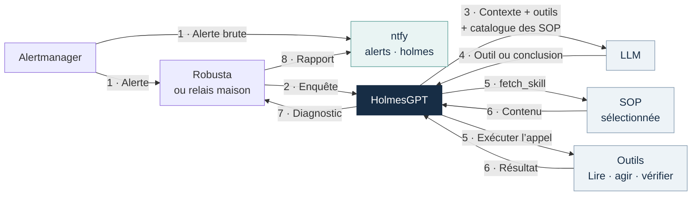
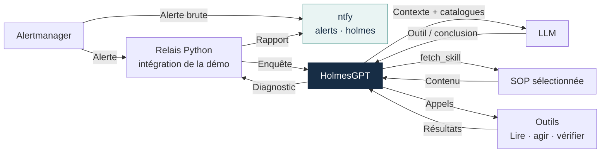
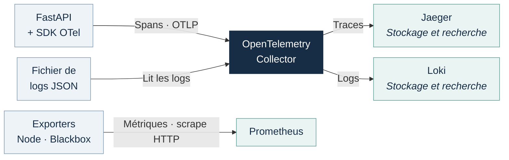
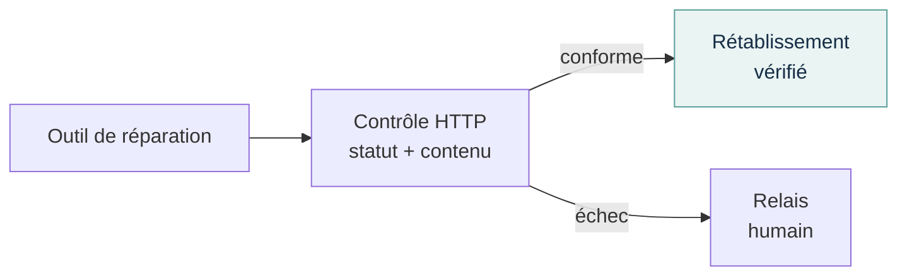
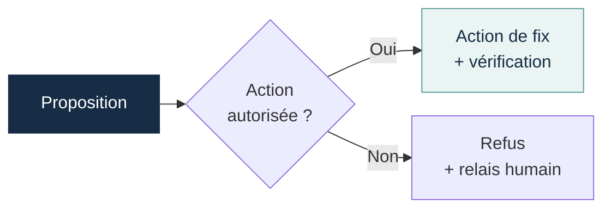
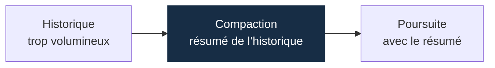
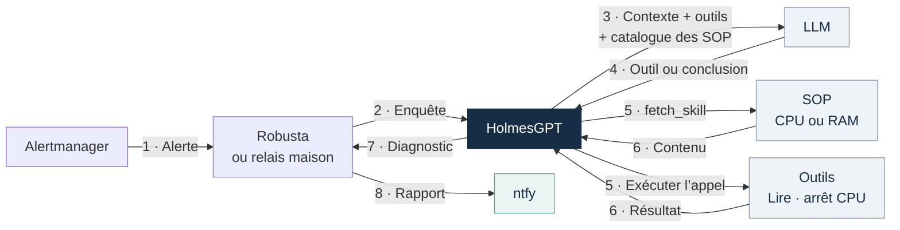

# HolmesGPT

<div class="cover-subtitle">Enquêter sur un incident<br>Agir sous contrôle</div>

<div class="cover-context">L’observabilité au service du LLM</div>

:: note ::

Cédric DELGEHIER

<!--
Ouverture : nous allons montrer ce que Holmes promet, comment on le branche
à une infrastructure et ce que nos essais ont réellement donné.
Le moteur d'enquête et le modèle sont deux composants distincts.
La démonstration porte sur une VM jetable.

Sources : https://holmesgpt.dev/0.42.0/
Thème : https://github.com/gureckis/slidev-theme-neversink
-->

---
layout: default
class: chapter-slide
title: "Pourquoi HolmesGPT ?"
name: besoin
routeAlias: besoin
level: 1
---

<div class="chapter-number">01</div>

# Pourquoi HolmesGPT ?

<p class="chapter-lead">Une alerte signale un symptôme. Pour décider de la suite, il faut encore choisir les vérifications, lire leurs résultats et expliquer ce qui se passe.</p>

<p class="chapter-question">Comment passer de cette alerte à une investigation compréhensible, puis à une réparation maîtrisée ?</p>

<!--
Cette ouverture relie la partie à la question commune : passer d'une alerte
à une investigation compréhensible, puis à une réparation maîtrisée.
Le cas de permissions de la VM sert de fil rouge. Les exemples externes
arrivent après le parcours complet, comme perspectives.
-->

---
title: "HolmesGPT, un agent d’investigation open source"
name: projet
routeAlias: projet
level: 2
layout: default
class: concept-slide introduction-slide explanation-slide
---

# HolmesGPT, un agent d’investigation open source

<p>Créé à l’origine par <strong>Robusta.dev</strong>, HolmesGPT a rejoint la <strong>Cloud Native Computing Foundation</strong> au niveau Sandbox le <strong>8 octobre 2025</strong>.</p>

<p>Il aide à diagnostiquer les incidents en consultant les outils déjà disponibles : métriques, logs, traces, état des services et historique des changements. Son périmètre peut couvrir Kubernetes, des VM, des services cloud ou des bases de données.</p>

<p>Le moteur d’enquête et le modèle de langage sont deux composants distincts. Le fournisseur du LLM est configurable ; le modèle choisit les vérifications et interprète les réponses des outils auxquels Holmes a accès.</p>

<p class="takeaway">L’objectif est de réduire le travail d’investigation et de préparer une réponse étayée. La durée et la qualité du diagnostic restent à mesurer sur les incidents réels.</p>

<!--
La CNCF confirme la date du 8 octobre 2025 et le niveau Sandbox. Ce statut
ne garantit ni la maturité de toutes les fonctions ni la justesse d'un diagnostic.
Le projet a été créé par Robusta.dev ; le dépôt mentionne aussi des contributions
majeures de Microsoft. Cela ne signifie pas que chaque intégration est disponible
dans toutes les versions ou dans toutes les installations.

Holmes consulte les sources configurées, dans la limite de leurs données et des
droits de ses outils. Les fournisseurs de LLM documentés comprennent notamment
OpenAI, Anthropic, Azure, Bedrock et Gemini ; un modèle local doit être compatible
avec le transport utilisé et suffisamment fiable dans ses appels d'outils.

Ne pas promettre un passage universel de plusieurs heures à quelques secondes.
Mesurer la durée, la qualité des preuves, les erreurs, les actions et les escalades.
L'existence de formations commerciales n'est pas une capacité du produit.

Sources, consultées le 3 novembre 2026 :
https://www.cncf.io/projects/holmesgpt/
https://github.com/robusta-dev/holmesgpt/blob/master/README.md
https://holmesgpt.dev/ai-providers/
-->

---
title: "Ce qui déclenche une enquête"
name: declencheurs
routeAlias: declencheurs
level: 2
layout: default
class: concept-slide trigger-modes-slide explanation-slide
---

# Ce qui déclenche une enquête

<p>Une enquête peut partir d’une alerte, d’une question humaine, d’un déploiement ou d’une vérification planifiée.</p>

<table class="guidance-table">
  <thead><tr><th>Déclencheur</th><th>Exemple d’usage</th></tr></thead>
  <tbody>
    <tr><td>Après une alerte</td><td>Un relais reçoit l’alerte et transmet le contexte de l’incident à Holmes.</td></tr>
    <tr><td>À la demande</td><td>Un opérateur pose une question via la CLI ou une interface reliée à Holmes.</td></tr>
    <tr><td>Après un déploiement</td><td>Comparer erreurs, latence et logs avant et après le changement.</td></tr>
    <tr><td>Selon un calendrier</td><td>Rechercher régulièrement une dégradation sur un service donné.</td></tr>
  </tbody>
</table>

<p class="muted">Dans la VM de démonstration, Alertmanager déclenche les enquêtes via notre relais HTTP.</p>

<!--
Cette slide introduit les déclencheurs dès la présentation de Holmes.
Le tableau distingue des points d’entrée et les intégrations nécessaires ;
les quatre parcours ne sont pas tous assurés par l’opérateur.
Dans Kubernetes, l’opérateur Holmes, encore en alpha, orchestre les contrôles
déclarés. Ils peuvent interroger des sources connectées, y compris les VM
et les services cloud. Le parcours à la demande peut utiliser la CLI ou une interface
intégrée ; un HealthCheck est une ressource d'exécution ponctuelle de l'opérateur.

Dans la documentation actuelle de l'opérateur :
- HealthCheck exécute une enquête ponctuelle et conserve son résultat ;
- ScheduledHealthCheck crée des HealthChecks selon un calendrier ;
- TriggeredHealthCheck crée un HealthCheck après un rollout de Deployment.
Ce dernier surveille les changements de pod template, pas toute modification
du cluster. Le délai et le cooldown sont configurables. Une planification
n'est pas une détection universelle des anomalies : les questions, sources,
fréquences et critères doivent être définis.

L'opérateur nécessite Kubernetes, mais ses cibles d'investigation ne sont pas
limitées à Kubernetes. La VM utilise seulement son relais Alertmanager :
aucune CRD ni aucun opérateur n'y sont installés. Un pipeline ou un ordonnanceur
pourrait appeler l'API sur VM ; ce serait une intégration à réaliser.

Ces possibilités sont décrites dans la documentation actuelle consultée le
3 novembre 2026. Vérifier la version avant de reprendre les ressources dans
une installation Holmes 0.42.0 ; cette slide ne change pas la version de la démo.
Chaque contrôle consomme du temps et des appels au LLM. La proactivité n'est
pas une garantie de détecter un problème avant tout impact utilisateur.

Sources :
https://holmesgpt.dev/operator/
https://holmesgpt.dev/operator/health-checks/
https://holmesgpt.dev/operator/scheduled-health-checks/
https://holmesgpt.dev/operator/triggered-health-checks/
https://holmesgpt.dev/operator/deployment-verification/
https://holmesgpt.dev/0.42.0/installation/cli-installation/
-->

---
title: "Ce que Holmes ajoute à l’alerte"
name: valeur-ajoutee
routeAlias: valeur-ajoutee
level: 2
layout: default
class: concept-slide contribution-slide explanation-slide
---

# Ce que Holmes ajoute à l’alerte

<div class="columns concept-columns">
<div>

## Le point de départ

Une alerte « service HTTP indisponible » indique qu’un contrôle échoue. Elle n’explique pas encore si le processus est arrêté, si une dépendance répond mal ou si un fichier est devenu illisible.

Sans enquête automatisée, une personne doit choisir les sources, lancer les vérifications, lire leurs résultats et décider de la suite.

</div>
<div>

## Le travail attendu de Holmes

Holmes consulte les métriques, l’état et les journaux accessibles, puis confronte ces observations aux hypothèses.

Si une **Standard Operating Procedure (SOP)** existe, elle guide les vérifications et les conditions d’action. Sinon, le modèle détermine les vérifications à partir de l’alerte et des résultats des outils disponibles.

Son rapport doit réduire le travail restant pour l’humain. Une réparation n’est possible que si un outil existe et si ses contrôles l’autorisent.

</div>
</div>

<p class="takeaway">La valeur ajoutée se juge sur l’enquête produite et la suite proposée, pas sur la reformulation de l’alerte.</p>

<!--
L'alerte peut déjà contenir du contexte ou un lien de runbook ; le point est
que son déclenchement ne démontre pas à lui seul la cause racine. Holmes
ajoute des lectures et leur interprétation selon les outils configurés.
Le comportement de notification et de réparation reste celui des intégrations
et des gardes décrites plus loin, pas une permission implicite du modèle.

Source : https://holmesgpt.dev/0.42.0/
Application : provision/holmesGPT/assets/bridge.py.
-->

---
title: "Après une alerte"
name: alerte
routeAlias: alerte
level: 2
layout: default
class: triggers-slide alert-workflow-slide
---

# Après une alerte

<p>Holmes envoie le contexte et les catalogues au LLM. Le modèle demande un outil - dont <code>fetch_skill</code> pour une SOP - puis reçoit son résultat pour décider de la suite.</p>

<div class="alert-diagram" data-waitfor="svg">



</div>

<p class="alert-loop-note"><strong>La boucle 3–6 se répète :</strong> la SOP chargée et les résultats enrichissent le contexte envoyé au LLM. Il peut demander un nouvel outil ou conclure, dans la limite de <code>MAX_STEPS</code>.</p>

<p class="muted">Dans le POC : relais maison ; topic <code>alerts</code> pour l’alerte brute, <code>holmes</code> pour le rapport.</p>

<!--
Le diagramme montre le rôle de l'intégration autour de Holmes : Robusta est
une possibilité documentée ; notre VM utilise un relais Python spécifique.
Robusta n'est pas installé dans ce POC. Son déploiement standard utilise Helm
et Kubernetes ; le libellé ne signifie pas un remplacement déjà réalisé.
Le diagnostic revient à l'intégration, qui publie le rapport dans ntfy.

Le chemin de l'alerte brute va directement d'Alertmanager à ntfy : son webhook
cible le topic alerts avec le template alertmanager de ntfy.
Ce chemin reste indépendant du relais, de Holmes et du modèle.
Le relais reçoit séparément le webhook et met l'enquête en file.
Holmes consulte les outils, recoupe les preuves et peut proposer une action.
Une réparation n'est possible que si un outil existe et si l'exécuteur l'autorise.
Un refus, un échec ou une absence de preuve doit conduire à un relais humain.
Le rapport distingue diagnostic, action réellement exécutée et résultat vérifié.

ReAct désigne le cycle où les observations guident les prochains appels
d'outils ; il ne rend pas visible tout le raisonnement interne du modèle.
Un tour de modèle peut demander plusieurs outils : MAX_STEPS ne compte pas
chaque commande séparément. Dans Holmes 0.42.0, les outils sont retirés du
dernier appel prévu pour demander une conclusion, sans garantir sa qualité.
Référence : https://github.com/robusta-dev/holmesgpt/blob/0.42.0/holmes/core/tool_calling_llm.py

Les numéros décrivent les phases, pas les unités comptées par MAX_STEPS.
Les deux branches 1 sont indépendantes ; leur réception n'a pas d'ordre garanti.
À chaque tour, 3 envoie le contexte au LLM, 4 revient avec un appel d'outil
ou une conclusion. Une demande fetch_skill passe donc du LLM à Holmes.
En 5–6, Holmes exécute l'appel demandé et recueille le résultat. La branche
SOP détaille fetch_skill ; la branche outils représente les autres appels.
Ces deux branches ne sont pas obligatoirement exécutées au même tour.
Les résultats rejoignent le contexte du prochain échange 3. La boucle
continue tant que le modèle demande des outils et que son budget le permet.
La conclusion permet le retour 7 à l'intégration, qui publie le rapport en 8.
Holmes orchestre les messages au LLM et l'exécution des outils ; le modèle
choisit les appels. Le contexte transmis inclut les instructions, l'incident,
les descriptions et paramètres des outils disponibles, les SOP déjà chargées
et les observations conservées dans l'historique. Le LLM ne reçoit pas les
exécutables des outils : Holmes exécute les appels demandés et lui retourne
les résultats. Les SOP ne sont pas toutes injectées au départ ; leur contenu
rejoint le contexte quand elles sont chargées.
Le nœud SOP représente les procédures accessibles : dans
la VM, fetch_skill charge leur contenu à travers un outil. Ce n'est pas un
service autonome ni un appel obligatoire à chaque tour.
Les outils de lecture interrogent Prometheus, Loki, Jaeger et l'état Linux ;
les outils d'action exposent uniquement les opérations autorisées.
Une investigation peut conclure sans action ou demander une intervention humaine.

Le parcours à la demande est une intégration possible, pas une interface
disponible dans notre POC. ntfy reçoit les rapports, mais ne transmet pas de
questions à Holmes.

Holmes propose une CLI officielle, par exemple :
holmes ask "Pourquoi le service HTTP ne répond plus ?"
Elle nécessite sa propre configuration de modèle et d'outils ; elle ne se
connecte pas automatiquement à notre serveur. Pour un parcours dans un chat
ou un ticket, il faut configurer une intégration qui transmette la question,
le contexte de l'incident et la réponse.

Dans cette démo, l'automatisation vient d'Alertmanager et d'un
relais développé pour ce besoin. Il ne faut pas attribuer la file, la
déduplication ou l'exécuteur spécifique au produit Holmes seul.
La voie d'alerte brute continue même si le modèle échoue.
Une SOP décrit une procédure ; elle ne programme aucune enquête.
Cette démo ne programme pas d'enquête périodique.
Ne pas promettre un comportement proactif 24/7 dans cette configuration.

Sources : provision/holmesGPT/assets/bridge.py et
provision/observability/monitoring.sh.
Documentation : https://holmesgpt.dev/0.42.0/
CLI : https://holmesgpt.dev/0.42.0/installation/cli-installation/
Intégrations : https://github.com/HolmesGPT/holmesgpt#-end-to-end-automation
Robusta vers ntfy : https://docs.robusta.dev/master/configuration/sinks/webhook.html
-->

---
layout: default
class: concept-slide model-decisions-slide explanation-slide
title: "Les décisions du modèle et les limites des outils"
name: decisions-modele
routeAlias: decisions-modele
level: 2
---

# Les décisions du modèle et les limites des outils

**Les pannes connues de cette démo pourraient être traitées par un script.** <br/>Le POC sert à observer comment Holmes exploite les preuves et prépare la suite de l’incident.

<div class="columns concept-columns">
<div>

## Le modèle (LLM) conduit l’enquête

Il propose des hypothèses et demande des lectures avec les outils disponibles. La SOP lui indique les vérifications attendues et les branches à suivre.

Il interprète les réponses, demande une action permise ou explique pourquoi il faut passer la main. Son rapport doit citer les observations qui justifient sa conclusion.

</div>
<div>

## Les outils et leurs permissions imposent les limites

Les permissions définissent les ressources accessibles et les actions possibles. **Les contrôles des outils peuvent refuser une demande du modèle.**

Dans cette démo, notre relais Python (substitut de Robusta) vérifie l’incident, les lectures requises et la cible avant d’agir, puis contrôle le résultat.

</div>
</div>

<p class="takeaway">On évalue la qualité de l’enquête et du passage de relais. Une réparation sur une panne connue ne suffit pas à démontrer la supériorité du LLM sur un script.</p>

<!--
La démonstration comporte trois actions fixes. Un script peut automatiser les
cas connus à partir de conditions explicites. Le POC montre comment relier
un agent d'investigation à l'observabilité et à un exécuteur qui contrôle les
mutations. Il ne mesure pas un avantage universel du LLM sur l'automatisation.

Les SOPs demandent notamment des lectures et des conditions. Le
modèle ne découvre pas seul toute la procédure et ne possède pas un shell
arbitraire. Il demande les outils disponibles et interprète leurs résultats.
Dans cette démo, le terme exécuteur désigne notre service Python spécifique,
pas un composant officiel de HolmesGPT. Holmes appelle les outils configurés ;
ce service applique les contrôles et les permissions des actions exposées.
L'exécuteur contrôle des lectures réussies et l'état courant. Il ne valide
pas formellement toute l'interprétation causale rédigée par le modèle.

Les contrôles incluent la bonne alerte active, le budget d'action,
le cooldown et les préconditions propres à la cible. Aucun texte de SOP ne
crée de permission système. La vérification HTTP reste déterministe.
Sources : provision/holmesGPT/assets/bridge.py, toolsets.yaml et sops/.
-->

---
layout: default
class: chapter-slide
title: "Comprendre le moteur d’investigation"
name: moteur
routeAlias: moteur
level: 1
---

<div class="chapter-number">02</div>

# Comprendre le moteur d’investigation

<p class="chapter-lead">Holmes relie un modèle de langage à des outils. Le modèle choisit les vérifications ; les outils donnent accès aux observations réelles.</p>

<p class="chapter-question">Après le parcours de l’alerte, regardons les preuves que les outils peuvent consulter.</p>

<!--
Cette ouverture relie la partie à la question commune : passer d'une alerte
à une investigation compréhensible, puis à une réparation maîtrisée.
Le cas de permissions de la VM sert de fil rouge. Les exemples externes
arrivent après le parcours complet, comme perspectives.
-->

---
title: "Ce que chaque source permet d’observer"
name: sources
routeAlias: sources
level: 2
layout: default
class: evidence-slide
---

# Ce que chaque source permet d’observer

<table class="signal-examples-table">
  <thead><tr><th>Source</th><th>Ce qu’on observe</th><th>Exemple illustratif</th></tr></thead>
  <tbody>
    <tr>
      <td><strong>Métriques</strong><br><span class="muted">Prometheus</span><br><span class="signal-definition">Des valeurs suivies dans le temps</span></td>
      <td>
        <svg class="signal-visual" viewBox="0 0 360 112" role="img" aria-label="Exemple illustratif : le taux d’erreur HTTP augmente jusqu’à 40 pour cent">
          <rect width="360" height="112" rx="8" fill="#101e34" />
          <text x="14" y="21" fill="#c9d8e6" style="font-size: 15px">Taux d’erreur HTTP</text>
          <path d="M43 35H316 M43 60H316 M43 85H316" stroke="#34465c" stroke-width="1" />
          <path d="M43 85L97 85L151 80L205 69L259 72L313 35V85Z" fill="#43d7e8" opacity="0.12" />
          <path d="M43 85L97 85L151 80L205 69L259 72L313 35" fill="none" stroke="#43d7e8" stroke-width="3" stroke-linejoin="round" />
          <circle cx="313" cy="35" r="4" fill="#43d7e8" />
          <text x="8" y="40" fill="#c9d8e6" style="font-size: 13px">40 %</text>
          <text x="19" y="89" fill="#c9d8e6" style="font-size: 13px">0</text>
          <text x="43" y="105" fill="#c9d8e6" style="font-size: 13px">10:00</text>
          <text x="277" y="105" fill="#c9d8e6" style="font-size: 13px">10:05</text>
        </svg>
      </td>
      <td>Le taux d’erreur passe de <strong>0 à 40 %</strong>.<br>On voit quand le service se dégrade et l’ampleur de l’impact.</td>
    </tr>
    <tr>
      <td><strong>Logs</strong><br><span class="muted">Loki</span><br><span class="signal-definition">Des événements datés</span></td>
      <td><pre class="signal-log"><span class="signal-log-info">10:04:12 INFO  GET /api/check</span><br><span class="signal-log-error">10:04:12 ERROR PermissionError</span><br>read /srv/demo/message.txt</pre></td>
      <td>Le journal signale un <strong>refus d’accès au fichier</strong>.<br>On obtient le message d’erreur et son horodatage.</td>
    </tr>
    <tr>
      <td><strong>Traces</strong><br><span class="muted">Jaeger · OTel</span><br><span class="signal-definition">Les opérations d’une requête</span></td>
      <td>
        <svg class="signal-visual" viewBox="0 0 360 112" role="img" aria-label="Exemple illustratif : une requête GET api check contient une opération de lecture de fichier en erreur">
          <rect width="360" height="112" rx="8" fill="#101e34" />
          <text x="14" y="20" fill="#c9d8e6" style="font-size: 13px">0 ms</text>
          <text x="298" y="20" fill="#c9d8e6" style="font-size: 13px">50 ms</text>
          <path d="M14 25V99 M181 25V99 M346 25V99" stroke="#34465c" stroke-width="1" />
          <rect x="14" y="32" width="332" height="26" rx="3" fill="#5677a5" />
          <text x="23" y="50" fill="white" style="font-size: 15px">GET /api/check · 503</text>
          <path d="M24 59V78H45" fill="none" stroke="#c9d8e6" stroke-width="1.5" />
          <rect x="45" y="65" width="273" height="26" rx="3" fill="#a74357" />
          <text x="54" y="83" fill="white" style="font-size: 15px">read message.txt · erreur</text>
        </svg>
      </td>
      <td>La requête échoue dans <strong>la lecture du fichier</strong>.<br>On relie l’erreur à son opération, sa durée et sa requête parente.</td>
    </tr>
  </tbody>
</table>

<p class="signal-state-note"><strong>État courant :</strong> systemd (service actif ?), montages et permissions Linux ; API Kubernetes (statut des pods).</p>

<!--
Ces exemples expliquent les types de données ; ce ne sont pas des résultats
capturés dans la démo. Les chiffres, horaires et durées sont illustratifs.
Les visuels sont créés dans le Slidev : courbe de métriques, extrait de journal
et cascade de spans. L'image fournie a seulement inspiré l'idée des trois
signaux représentés visuellement ; aucun pixel de cette image n'est réutilisé.
L'exemple Kubernetes ne décrit pas la VM Linux.

La trace est une cascade d'opérations applicatives instrumentées, avec leurs
relations parent-enfant. Il ne s'agit pas d'une capture de tous les appels
système du processus comme avec strace. Les deux spans du visuel ont un
statut en erreur ; les timestamps et les durées ne proviennent pas de Jaeger.

Les métriques forment des séries temporelles : taux d'erreurs, consommation
CPU, mémoire, latence. Prometheus les collecte ou les calcule à partir des
mesures exposées. Elles montrent une évolution ou un impact, sans fournir
à elles seules la cause d'une erreur.

Un log décrit un événement émis par un composant, avec son horodatage et les
champs disponibles : niveau, service, message, identifiant de requête.
Loki stocke et permet de rechercher ces journaux.

Une trace regroupe les spans d'une requête instrumentée. Chaque span décrit
une opération, son début, sa durée, ses attributs et éventuellement une erreur.
Cela permet de localiser l'opération en échec ou la dépendance lente.
OpenTelemetry fournit l'instrumentation et le transport ; Jaeger conserve
et permet de consulter les traces. Une trace ne contient pas tout le trafic :
elle dépend de l'instrumentation et de l'échantillonnage.

L'API Kubernetes expose la configuration souhaitée, l'état observé et des
événements à rétention limitée. Le statut d'un conteneur peut indiquer son
dernier arrêt OOMKilled ; les métriques aident à examiner la pression mémoire
avant cet arrêt. CrashLoopBackOff décrit des redémarrages en échec, pas leur cause.
Sur Linux, les lectures de systemd, des montages et des permissions donnent
un état système comparable pour les besoins de notre enquête.

Références : https://prometheus.io/docs/concepts/data_model/
https://grafana.com/docs/loki/latest/get-started/overview/
https://opentelemetry.io/docs/concepts/signals/traces/
https://kubernetes.io/docs/concepts/overview/working-with-objects/
https://kubernetes.io/docs/concepts/workloads/pods/pod-lifecycle/
-->

---
layout: default
class: chapter-slide
title: "Construire notre environnement"
name: environnement
routeAlias: environnement
level: 1
---

<div class="chapter-number">03</div>

# Construire notre environnement

<p class="chapter-lead">Une VM Linux héberge un service HTTP, sa collecte d’observabilité et le relais vers Holmes. Le serveur du modèle est accessible par API.</p>

<p class="chapter-question">Le parcours de la démo : application → observations → alerte → enquête → rapport.</p>

<!--
Cette ouverture relie la partie à la question commune : passer d'une alerte
à une investigation compréhensible, puis à une réparation maîtrisée.
Le cas de permissions de la VM sert de fil rouge. Les exemples externes
arrivent après le parcours complet, comme perspectives.
-->

---
title: "La VM relie l’application, les preuves et Holmes"
routeAlias: architecture-vm
layout: default
class: concept-slide vm-architecture-slide explanation-slide
name: architecture-vm
level: 2
---

# La VM relie l’application, les preuves et Holmes

<p><a href="https://fastapi.tiangolo.com/" target="_blank" rel="noopener noreferrer">FastAPI</a> sert la page et <code>/api/check</code>, qui lit le fichier de démonstration.</p>

<p class="architecture-stack"><strong>Observabilité :</strong> <a href="https://prometheus.io/docs/introduction/overview/" target="_blank" rel="noopener noreferrer">Prometheus</a>, <a href="https://prometheus.io/docs/alerting/latest/alertmanager/" target="_blank" rel="noopener noreferrer">Alertmanager</a>, <a href="https://github.com/prometheus/blackbox_exporter" target="_blank" rel="noopener noreferrer">Blackbox Exporter</a>, <a href="https://github.com/prometheus/node_exporter" target="_blank" rel="noopener noreferrer">Node Exporter</a>, <a href="https://opentelemetry.io/docs/collector/" target="_blank" rel="noopener noreferrer">OpenTelemetry Collector</a>, <a href="https://www.jaegertracing.io/docs/latest/" target="_blank" rel="noopener noreferrer">Jaeger</a>, <a href="https://grafana.com/docs/loki/latest/" target="_blank" rel="noopener noreferrer">Loki</a> et <a href="https://grafana.com/docs/grafana/latest/" target="_blank" rel="noopener noreferrer">Grafana</a>.</p>

<div data-waitfor="svg">



</div>

<p>Les outils interrogent Prometheus, Loki, Jaeger et l’état Linux. <a href="https://grafana.com/docs/grafana/latest/" target="_blank" rel="noopener noreferrer">Grafana</a> permet à l’humain d’explorer ces signaux. Le diagnostic revient au relais, qui le publie dans <a href="https://docs.ntfy.sh/" target="_blank" rel="noopener noreferrer">ntfy</a>.</p>

<!--
Vue logique de l'environnement existant, sans ajout de service.
Le service demo-fastapi lance Uvicorn, qui exécute l'application FastAPI.
Le même processus sert la page / et l'API /api/check. Aucun reverse proxy
ni second serveur applicatif n'est nécessaire dans cette démo.
La page ne lit pas le fichier de données : elle reste disponible si seule
la dépendance utilisée par /api/check est illisible ou absente.
La liste des briques garde la pile d'observabilité explicitement visible.
Blackbox Exporter sonde le service et Prometheus collecte ses métriques ainsi
que celles de Node Exporter. FastAPI pousse ses spans par OTLP/HTTP et écrit
ses logs dans un fichier que le Collector lit. Le Collector transmet les
logs à Loki et les traces à Jaeger. Il n'existe pas de flux Prometheus vers Loki.

Le schéma reprend le sens des échanges de la slide alerte. Il sépare le relais
et Holmes : Alertmanager déclenche le relais, qui appelle Holmes. Le diagnostic
revient au relais pour la notification. L'alerte brute va directement à ntfy.
Les résultats d'outils et les SOP chargées rejoignent le prochain contexte du LLM.
Les outils interrogent les sources ; aucun flux ne pousse spontanément les
preuves dans Holmes. Les sources et le service HTTP sont décrits dans la liste
et le texte, sans dupliquer tous leurs flux de collecte dans ce schéma.

Les liens du schéma et de la liste ouvrent la documentation des composants.
Le relais spécifique à notre POC renvoie à la slide qui explique son rôle.
La configuration Mermaid securityLevel loose est limitée à ce diagramme local
rédigé dans le dépôt ; elle permet ses liens explicites.

systemd pilote le conteneur Holmes et le relais Python. La VM n'est pas un
cluster Kubernetes ; ni Robusta ni l'opérateur Holmes n'y sont déployés.
Le modèle est un service distinct, joint par une API compatible OpenAI.
Grafana sert à l'exploration humaine ; Holmes lit les sources avec ses outils.

L'instrumentation FastAPI crée automatiquement le span HTTP. Le code ajoute
un span enfant pour la lecture du fichier. Les spans ASGI send/receive sont
exclus pour garder la trace lisible. Aucun résultat de performance ni de
diagnostic n'est mesuré par cette représentation.

Sources : provision/observability/fastapi.sh, assets/fastapi_app.py, monitoring.sh,
telemetry.sh, provision/holmesGPT/install.sh et assets/toolsets.yaml.
-->

---
title: "Logs et traces : deux lectures d’une requête"
name: logs-et-traces
routeAlias: logs-et-traces
level: 2
layout: default
class: concept-slide logs-traces-slide explanation-slide
---

# Logs et traces : deux lectures d’une requête

<div class="columns concept-columns">
<div>

## Le log donne le détail de l’événement

L’API FastAPI écrit un événement daté avec son message, son niveau et ses champs. Ici, il explique pourquoi la lecture a échoué.

```json
{
  "message": "Demo file cannot be read",
  "error_type": "PermissionError",
  "trace_id": "…"
}
```

Ce message peut être très précis, mais ne décrit pas automatiquement toutes les opérations de la requête ni leurs relations.

</div>
<div>

## La trace donne le parcours de la requête

Une trace regroupe des <strong>spans</strong>. Un span représente une opération avec un début, une fin, un statut et éventuellement un parent.

<div class="trace-spans-example">
<svg class="signal-visual" viewBox="0 0 360 112" role="img" aria-label="Exemple illustratif : une requête GET api check contient une opération de lecture de fichier en erreur">
  <rect width="360" height="112" rx="8" fill="#101e34" />
  <text x="14" y="20" fill="#c9d8e6" style="font-size: 13px">0 ms</text>
  <text x="298" y="20" fill="#c9d8e6" style="font-size: 13px">50 ms</text>
  <path d="M14 25V99 M181 25V99 M346 25V99" stroke="#34465c" stroke-width="1" />
  <rect x="14" y="32" width="332" height="26" rx="3" fill="#5677a5" />
  <text x="23" y="50" fill="white" style="font-size: 15px">GET /api/check · 503</text>
  <path d="M24 59V78H45" fill="none" stroke="#c9d8e6" stroke-width="1.5" />
  <rect x="45" y="65" width="273" height="26" rx="3" fill="#a74357" />
  <text x="54" y="83" fill="white" style="font-size: 15px">read message.txt · erreur</text>
</svg>
</div>

La barre HTTP représente le **span parent** ; la lecture du fichier est son **span enfant**. La trace situe l’opération en erreur dans la requête.

</div>
</div>

<p class="takeaway">Un même <code>trace_id</code> permet de passer du log détaillé à la trace de la requête.</p>

<!--
Les extraits sont abrégés et illustratifs, pas une capture de données.
La cascade de spans reprend le visuel de la slide sources : un span HTTP
parent et un span enfant pour la lecture du fichier. Les durées affichées
sont illustratives et ne proviennent pas de Jaeger. Les deux opérations
partagent un trace_id, mais possèdent des span_id distincts.
Une trace peut aussi relier plusieurs services si leur instrumentation
propage le contexte de trace.
Le log réel de FastAPI contient aussi timestamp, service, level, route,
status et span_id.
Le champ trace_id contient un identifiant hexadécimal complet, pas une ellipse.

Les logs peuvent être structurés, porter un identifiant de requête et inclure
des durées. La distinction n'est pas texte contre données structurées ni
erreurs contre succès. Un span conserve explicitement une opération, sa durée
et sa relation avec les autres spans de la trace ; un log représente un événement.
Les deux signaux peuvent exister pour des requêtes réussies ou échouées.

Dans la démo, l'instrumentation FastAPI crée le span SERVER GET /api/check.
Le code applicatif ajoute le span enfant read demo message. L'exception de lecture est enregistrée par
le contexte du span enfant ; le parent reçoit un statut ERROR et error.type.
Le log JSON contient le même trace_id et le span_id du parent HTTP.
Ces deux spans décrivent une requête et sa lecture de fichier au sein d'un
seul service. Une trace peut être utile sans être distribuée entre services.

Sources : provision/observability/assets/fastapi_app.py et telemetry.sh.
Référence : https://opentelemetry.io/docs/concepts/signals/traces/
Lecture complémentaire sur les logs :
https://www.stephane-robert.info/docs/observabilite/fondamentaux/signaux/logs/
-->

---
title: "Des signaux aux backends d’observabilité"
name: collecte-traces
routeAlias: collecte-traces
level: 2
layout: default
class: concept-slide trace-export-slide explanation-slide
---

# Des signaux aux backends d’observabilité

<div class="telemetry-code-row">
<div>

```python
with tracer.start_as_current_span("read demo message"):
    message = message_file.read()
```

</div>
<p>L’instrumentation FastAPI crée le span HTTP. Ce code ajoute un <strong>span enfant</strong> ; le SDK exporte les spans en arrière-plan.</p>
</div>

<div data-waitfor="svg">



</div>

<p class="telemetry-roles">Le Collector lit les logs JSON et le journal systemd. <strong>Prometheus interroge les exporters :</strong> Node Exporter mesure l’hôte, Blackbox Exporter sonde FastAPI.</p>

<!--
Ce parcours correspond aux scripts de la VM, pas à une nouvelle installation.
FastAPI configure TracerProvider et BatchSpanProcessor avec un
OTLPSpanExporter HTTP. L'export est asynchrone, avec une temporisation de lot
de 500 ms dans cette configuration. Le Collector applique memory_limiter et
batch avant l'export OTLP/HTTP vers le récepteur OTLP de Jaeger.

Le SDK pousse les spans vers le Collector : ce n'est pas un scrape Prometheus
et Jaeger ne vient pas chercher les événements dans le code ou les fichiers.
Le pipeline logs/fastapi lit requests.jsonl avec file_log et json_parser,
puis exporte vers l'endpoint OTLP de Loki, séparément du pipeline traces.
Le pipeline logs/linux lit aussi le journal systemd avec le receiver journald
et transmet ces logs à Loki. Loki est ici le backend d'ingestion, de stockage
et de requête ; il ne lit pas les fichiers de la VM. L'OpenTelemetry Collector
assure la collecte et l'acheminement des logs. Aucun Promtail n'est utilisé.

La flèche fichiers/journal vers Collector décrit la circulation des données :
c'est le Collector qui lit activement ces sources. De même, les métriques vont
des exporters à Prometheus, mais les requêtes HTTP de scrape sont initiées par
Prometheus. Les deux exporters sont groupés pour la lisibilité : Node Exporter
expose CPU, mémoire, disques et systemd ; Blackbox sonde / et /api/check.
Les métriques applicatives/hôte représentées ici ne transitent pas par le
Collector. Prometheus scrape aussi les métriques internes de la pile, dont
celles du Collector ; ces flux de supervision interne sont omis du schéma.
L'application FastAPI n'expose pas de route /metrics dans cette démo.

Un Collector OpenTelemetry est optionnel pour des traces : Jaeger accepte
également OTLP directement. Ici nous utilisons un Collector distinct pour
les pipelines traces et logs, avec memory_limiter et batch. Aucun filtrage
ou masquage de données sensibles supplémentaire n'est prétendu configuré.

FastAPIInstrumentor.instrument_app installe l'instrumentation HTTP : méthode,
route, statut et durée. Le SDK extrait le traceparent entrant ou crée une
nouvelle trace. Le span read demo message est ajouté manuellement autour de
la lecture du fichier : le framework ne connaît pas cette opération métier.
Aucun Collector ne rend spontanément observable une opération non instrumentée.

Pour une trace distribuée, les appels entre services doivent propager le
contexte, typiquement avec traceparent. L'instrumentation FastAPI extrait ce
contexte entrant. S'il n'y en a pas, elle commence une nouvelle trace.
Le span fichier reprend le contexte HTTP, même dans le thread du handler synchrone.
La collecte dépend aussi de l'échantillonnage et de la réussite des exports.

Sources : provision/observability/assets/fastapi_app.py, fastapi.sh,
telemetry.sh et monitoring.sh.
Références : https://opentelemetry.io/docs/languages/python/instrumentation/
https://opentelemetry.io/docs/collector/
https://grafana.com/docs/loki/latest/send-data/otel/
https://prometheus.io/docs/introduction/overview/
-->

---
layout: default
class: chapter-slide
title: "Faire vivre une enquête"
name: incident
routeAlias: incident
level: 1
---

<div class="chapter-number">04</div>

# Faire vivre une enquête

<p class="chapter-lead">La sonde HTTP échoue alors que l’API FastAPI tourne encore. Nous allons suivre une erreur de lecture du fichier, depuis le symptôme jusqu’au résultat de l’intervention.</p>

<p class="chapter-question">Quelles preuves permettent d’autoriser une réparation, puis d’affirmer que le service est rétabli ?</p>

<!--
Cette ouverture relie la partie à la question commune : passer d'une alerte
à une investigation compréhensible, puis à une réparation maîtrisée.
Le cas de permissions de la VM sert de fil rouge. Les exemples externes
arrivent après le parcours complet, comme perspectives.
-->

---
title: "La sonde échoue, mais le processus tourne"
routeAlias: panne-permissions
layout: default
class: concept-slide incident-start-slide explanation-slide
name: panne-permissions
level: 2
---

# La sonde échoue, mais le processus tourne

<p>Dans la démo, l’API FastAPI lit <code>/srv/demo/message.txt</code> pour répondre. Nous allons retirer ses permissions de lecture, sans arrêter le processus.</p>

```bash
# Sur la VM
sudo chmod 000 /srv/demo/message.txt
```

<p>FastAPI reste actif et sert sa page d’accueil, mais <code>/api/check</code> renvoie maintenant HTTP 503. Son <strong>log</strong> indique <code>PermissionError</code> et sa <strong>trace</strong> localise l’échec sur la lecture du fichier. Prometheus constate l’échec de la sonde, puis Alertmanager envoie l’alerte au relais.</p>

<p class="takeaway">L’alerte signale une réponse HTTP en échec. Elle ne démontre ni un processus arrêté ni une permission à modifier : l’enquête doit encore vérifier la cause.</p>

<!--
Début du fil rouge. Comportement attendu du scénario défini dans le code,
pas une capture d'une nouvelle exécution en direct. L'injection n'a pas été
exécutée pour produire cette slide. Ne la lancer que dans la VM Labstack.
Le service demo-fastapi tourne sous www-data et ne peut pas lire le fichier
de mode 000. La page / reste disponible ; l'alerte concernée est
DemoApiUnavailable. Attendre la fin de l'enquête avant toute autre panne.

Si une récupération manuelle est nécessaire dans la VM :
sudo chmod 0644 /srv/demo/message.txt
Les délais d'alertes sont raccourcis pour la démo. Le modèle ajoute sa propre
latence. Les commandes complètes des trois scénarios restent sur la slide Démo.

Sources : provision/observability/assets/fastapi_app.py, monitoring.sh,
provision/holmesGPT/assets/sops/file-permissions/SKILL.md.
-->

---
title: "Des preuves aux décisions de Holmes"
name: preuves-http
routeAlias: preuves-http
level: 2
layout: default
class: concept-slide evidence-correlation-slide explanation-slide
---

# Des preuves aux décisions de Holmes

<p>Chaque preuve précise l’hypothèse et guide la prochaine vérification.</p>

<table class="guidance-table evidence-decisions-table">
  <thead><tr><th>Preuve recueillie</th><th>Ce que Holmes en déduit</th><th>Vérification suivante</th></tr></thead>
  <tbody>
    <tr><td>Sonde : HTTP <code>503</code></td><td>Le service répond, mais le traitement échoue.</td><td>Localiser l’échec dans la trace.</td></tr>
    <tr><td>Span <code>read demo message</code> en erreur</td><td>La lecture échoue ; sa cause reste à préciser.</td><td>Lire le log associé au même <code>trace_id</code>.</td></tr>
    <tr><td>Log : <code>PermissionError</code></td><td>L’accès au fichier est refusé.</td><td>Contrôler le fichier, le montage et l’utilisateur du service.</td></tr>
    <tr><td>Fichier présent, mode <code>000</code> ; montage et service actifs</td><td>Le fichier est illisible par le service.</td><td>Vérifier la SOP et l’outil de réparation autorisé.</td></tr>
  </tbody>
</table>

<p class="takeaway">Conclusion : défaut de permissions. La SOP et l’outil encadrent la réparation.</p>

<!--
Parcours illustratif du scénario de permissions, pas une capture de réponse
du modèle et pas un ordre de collecte imposé. Le tableau résume les
déductions justifiables à partir des preuves et les lectures utiles ensuite ;
il ne prétend pas reproduire une réflexion interne du modèle.
Holmes peut regrouper les lectures ou suivre un autre ordre. La SOP peut
être chargée dès le début : la dernière ligne rappelle les conditions à
vérifier avant l'action, pas un chargement nécessairement tardif de la SOP.

La sonde échoue sur une réponse HTTP d'erreur, même si le processus tourne.
La trace localise l'échec dans le span de lecture du message ; le log JSON
de FastAPI contient error_type=PermissionError et le même trace_id.
L'état système confirme la présence du fichier et le mode 000. FastAPI
tourne avec un utilisateur sans privilège : ce mode empêche sa lecture.

Une sonde seule ne distingue pas service arrêté, erreur de dépendance et
problème de permissions. La trace localise une opération ; le log précise
l'erreur ; la lecture de l'état vérifie les conditions actuelles.
Un fichier manquant ou un montage absent demande une autre hypothèse et
interdit la réparation de permissions prévue pour ce scénario.

Dans la VM, ces informations viennent des outils read_demo_metrics,
read_demo_traces, read_demo_logs et read_demo_status. Cette enquête ne
consulte pas Kubernetes. La SOP et les gardes de réparation sont présentées
plus loin ; recueillir les preuves ne donne pas une autorisation d'agir.

Sources : provision/observability/assets/fastapi_app.py,
provision/holmesGPT/assets/toolsets.yaml et bridge.py.
-->

---
title: "Une action réussie ne suffit pas"
name: verification
routeAlias: verification
level: 2
layout: default
class: concept-slide verification-slide explanation-slide
---

# Une action réussie ne suffit pas

<p>Une commande peut réussir alors que l’incident continue : le processus démarre, mais une dépendance reste inaccessible ou la réponse HTTP n’a pas le contenu attendu. Le succès de l’action doit donc être suivi d’un contrôle du service.</p>

<div data-waitfor="svg">



</div>

<p>Dans la démo, l’outil de réparation refait une requête et vérifie <strong>HTTP 200 et le contenu attendu</strong>. Si ce contrôle échoue, Holmes doit rapporter « action exécutée, rétablissement non confirmé » plutôt que déclarer l’incident résolu.</p>

<!--
L'exécuteur contrôle lui-même la réponse HTTP après le démarrage du service
ou la restauration des permissions. Il vérifie le contenu attendu, pas seulement
un code HTTP ou un processus actif. Le texte du modèle ne remplace pas ce contrôle.
Une vérification en échec ne permet pas de déclarer l'incident résolu et ne
déclenche pas de nouvelle tentative automatique de réparation.

Source : provision/holmesGPT/assets/bridge.py et tests/holmes.sh.
-->

---
layout: default
class: chapter-slide
title: "Maîtriser l’agent"
name: maitrise
routeAlias: maitrise
level: 1
---

<div class="chapter-number">05</div>

# Maîtriser l’agent

<p class="chapter-lead">Nous avons vu une réparation possible. Il reste à définir quand elle est permise, quand l’agent doit s’arrêter et quelles ressources son enquête peut consommer.</p>

<p class="chapter-question">La SOP guide les décisions ; les outils et leurs permissions imposent les limites.</p>

<!--
Cette ouverture relie la partie à la question commune : passer d'une alerte
à une investigation compréhensible, puis à une réparation maîtrisée.
Le cas de permissions de la VM sert de fil rouge. Les exemples externes
arrivent après le parcours complet, comme perspectives.
-->

---
title: "Dans la SOP : cadrer l’enquête"
name: sop-enquete
routeAlias: sop-enquete
level: 2
layout: default
class: concept-slide sop-content-slide explanation-slide
---

# Dans la SOP : cadrer l’enquête

<p>Une SOP doit permettre à Holmes de reconnaître le bon incident, de choisir les vérifications utiles et de comprendre ce que leurs résultats permettent de conclure.</p>

<table class="guidance-table">
  <thead><tr><th>À préciser</th><th>Exemple pour un service HTTP</th></tr></thead>
  <tbody>
    <tr><td>Déclencheur et périmètre</td><td>Nom de l’alerte, service et environnement visés, propriétaire et exceptions telles qu’une maintenance connue.</td></tr>
    <tr><td>Comportement attendu</td><td>HTTP 200 et contenu attendu : le seul fait que le processus soit actif ne démontre pas la santé du service.</td></tr>
    <tr><td>Hypothèses et preuves</td><td>Quelles lectures distinguent service arrêté, dépendance en erreur et fichier illisible ? Qu’est-ce qui reste inconnu ?</td></tr>
    <tr><td>Outils et collecte</td><td>Nommer les outils, la période à consulter et les champs utiles ; borner le volume sans masquer les erreurs.</td></tr>
  </tbody>
</table>

<!--
Trame recommandée à partir des cours, appliquée à une SOP Holmes.
Le nom et la description du fichier doivent permettre de choisir la bonne
procédure. Identifier aussi propriétaire, version et date de révision dans
la documentation ou les métadonnées gérées par l'équipe.

Préciser les prérequis, dépendances et exceptions : maintenance connue,
service volontairement arrêté, environnement hors périmètre. Ces éléments
doivent venir d'une source fiable ; le modèle ne doit pas les inventer.
La VM ne reçoit pas ici un nouveau mécanisme de calendrier de maintenance.

Présenter les vérifications discriminantes avec le nom de l'outil et la
signification de son résultat. Un inventaire de toutes les causes possibles
est moins utile qu'une première lecture qui distingue deux hypothèses.
Inclure un exemple de succès et un cas où il faut s'abstenir si cela aide
réellement ; éviter une encyclopédie de cas particuliers dans chaque SOP.

Sources pédagogiques : claude_ccar-p/docs/cours/07-productivite-exploitation.md,
§7 Documentation, §8 Diagnostic assisté et §9 Runbook opérationnel ;
docs/cours/02-modeles-prompting-contexte.md, §3 Choisir la technique ;
docs/cours/03-integration.md, §2 Contrats d'outils.
-->

---
title: "Exemple : une SOP pour le service HTTP"
name: sop-fichier
routeAlias: sop-fichier
level: 2
layout: default
class: sop-slide
---

# Exemple : une SOP pour le service HTTP

<div class="columns sop-columns">
<div>

```markdown
---
name: demo-http-service
description: Diagnostiquer DemoHttpUnavailable.
---
1. Lire l'état, les métriques et les logs.
2. Confirmer : sonde en échec ET service arrêté.
3. Appeler start_demo_fastapi une fois si autorisé.
4. Rapporter le résultat HTTP vérifié.
```

<p class="muted">Extrait de la SOP HTTP, abrégé et traduit</p>

<p class="sop-guidance">Versionner la SOP, puis la rejouer sur une panne et sur un cas où l’action doit être refusée.</p>

</div>
<div class="sop-guidance">

## Une SOP, un fichier

```text
sops/
├── http-service/SKILL.md
├── file-permissions/SKILL.md
├── cpu-pressure/SKILL.md
├── memory-pressure/SKILL.md
├── disk-space/SKILL.md
├── missing-mount/SKILL.md
└── monitoring/SKILL.md
```

Nom et description guident le choix. Le contenu précise les preuves, les actions permises et l’escalade.

</div>
</div>

<p class="takeaway">Robusta ou notre relais transmet l’alerte ; <strong>le modèle choisit la SOP dans le catalogue de Holmes et demande <code>fetch_skill</code></strong>. Le nom et la description guident ce choix.</p>

<!--
L'extrait est une version abrégée et traduite de la SOP HTTP de la VM,
pas le fichier exact.
Le vrai fichier exige la corrélation entre sonde HTTP, état systemd et logs.
Il interdit de redémarrer d'autres services et de rejouer une action refusée.
Dans la VM, build_prompt transmet les labels de l'incident et demande au
modèle de choisir une SOP dans le catalogue natif de Holmes, sans en imposer
le nom. La description guide ce choix ; ce n'est pas une règle de routage
Alertmanager. Les contrôles de réparation utilisent toujours le nom d'alerte ;
une description de SOP ne donne pas de droit.

Robusta peut recevoir les alertes, déclencher Holmes et transmettre les
résultats avec ses playbooks et ses destinations configurées. Cela décrit
son rôle d'intégration, sans prétendre qu'il reproduit automatiquement les
gardes propres au relais de cette démo.
Robusta n'est pas installé dans cette VM.
Robusta n'a pas besoin de connaître les fichiers SOP pour déclencher Holmes.
Lorsque des SOPs sont configurées dans Holmes, leurs noms et descriptions
alimentent le catalogue fourni au modèle. Le modèle peut sélectionner une
procédure pertinente et demander fetch_skill pour en charger le contenu.
En l'absence de procédure pertinente, il enquête avec les outils disponibles.
Notre relais laisse aussi le modèle choisir : aucune table alerte/SOP n'est
nécessaire. Si aucune procédure ne convient, le modèle utilise les lectures
disponibles et signale le manque ; il n'improvise pas de réparation.

La VM utilise custom_skill_paths pour son répertoire local de SOPs.
Les SOPs sont des fichiers séparés sous provision/holmesGPT/assets/sops/.
Le provisioning copie ce dossier dans /etc/labstack-holmes/sops sur la VM,
puis le monte en lecture seule sous /etc/holmes/sops dans le conteneur.
Les SOPs sont toujours disponibles ; Holmes charge celle de l'incident.

Sources : provision/holmesGPT/assets/sops/http-service/SKILL.md,
provision/holmesGPT/assets/render_config.py et bridge.py.
https://github.com/HolmesGPT/holmesgpt#-end-to-end-automation
https://docs.robusta.dev/master/configuration/sinks/webhook.html
-->

---
title: "La liberté d’agir est explicite"
name: autorisations
routeAlias: autorisations
level: 2
layout: default
class: actions-slide explanation-slide
---

# La liberté d’agir est explicite

<div class="columns action-columns">
<div>

**La SOP guide l’enquête**<br>
Holmes charge la procédure de l’incident : preuves à réunir, conditions de réparation et situations qui nécessitent un humain. La SOP ne donne aucun droit système.

</div>
<div>

**Les outils bornent les actions**<br>
Trois actions fixes sont disponibles : démarrer le service HTTP, restaurer les permissions du fichier ou arrêter le stress CPU identifié. L’exécuteur vérifie chaque demande. La RAM reste une intervention humaine.

</div>
</div>

<div class="action-diagram" data-waitfor="svg">



</div>

<p class="muted">L’exécuteur exige un incident actif, les preuves attendues et la cible prévue. Il limite les tentatives et vérifie le rétablissement ; un refus ou un échec est transmis à l’humain.</p>

<!--
Aucun sélecteur de mode n'est nécessaire. Les SOPs sont toujours disponibles,
et l'exécuteur contrôle indépendamment chaque demande d'action.

La VM autorise le démarrage de demo-fastapi, le retour du fichier régulier
/srv/demo/message.txt du mode 000 à 0644 et l'arrêt du job labstack-demo-cpu
identifié. L'exécuteur vérifie le contenu HTTP pour les deux premières actions,
la baisse du CPU et la résolution de l'alerte pour la troisième. Le stress RAM
ne peut pas être arrêté par Holmes, et aucun outil ne permet de tuer un PID arbitraire.
Il impose aussi un délai global d'une minute entre tentatives. Le journal
persistant évite de répéter une mutation après redémarrage.
Holmes n'a pas de shell hôte ni de socket Docker. L'exécuteur a les droits
nécessaires pour ces trois opérations. Une SOP n'est pas une barrière d'accès.

Sources : provision/holmesGPT/README.md et assets/bridge.py.
-->

---
title: "Une SOP cadre les pistes et les refus d’agir"
name: sop-refus
routeAlias: sop-refus
level: 2
layout: default
class: concept-slide sop-branches-slide explanation-slide
---

# Une SOP cadre les pistes et les refus d’agir

<p>La SOP guide les vérifications, les changements de piste et les refus d’action.</p>

<table class="guidance-table">
  <thead><tr><th>Constat</th><th>Décision décrite dans la SOP</th></tr></thead>
  <tbody>
    <tr><td>API atteinte + <code>PermissionError</code></td><td>Vérifier fichier, montage et droits avant DNS ou réseau. Cette priorité repose sur une preuve.</td></tr>
    <tr><td>Fichier ou montage absent, ou preuve contradictoire</td><td>Sortir de la SOP de permissions et réviser l’hypothèse. Une autre SOP peut devenir pertinente.</td></tr>
    <tr><td>Outil indisponible, conditions inconnues ou action refusée</td><td>Passer la main avec les preuves et les vérifications manquantes, sans forcer une action ni élargir les droits.</td></tr>
  </tbody>
</table>

<p class="takeaway">Après une action, vérifier le rétablissement. Un échec exige un rapport et une reprise humaine.</p>

<!--
Cette slide réunit l'exclusion conditionnelle des pistes et les conditions
de refus d'action. Les décisions sont illustrées par le fichier FastAPI,
pas par une orchestration native de Holmes ni une nouvelle procédure installée.
La SOP guide le modèle ; les outils contrôlent les préconditions et le budget.

API atteinte et PermissionError donnent la priorité au fichier, au montage
et aux droits. Ils n'excluent pas définitivement DNS ou le réseau : une
preuve contradictoire doit rouvrir la piste. Chaque lecture hors sujet
consomme du temps, des appels d'outils et du contexte.

Un montage absent ne se répare pas en changeant les droits du répertoire
qui apparaît en dessous. Un fichier manquant ne se recrée pas avec chmod.
Sortir de la SOP conduit à une autre procédure pertinente ou à une escalade,
sans improviser une action plus large.

Même panne confirmée, outil absent, précondition inconnue ou refus imposent
de passer la main. Après une action, contrôler le service : un résultat non
vérifié n'autorise ni une deuxième mutation ni une escalade de privilèges.
Le rapport précise les preuves, les vérifications manquantes et l'intervention
humaine attendue. Une lecture en erreur reste visible dans le rapport.

Exercer le parcours nominal, les preuves contradictoires, les sorties de
périmètre, l'outil indisponible, le refus et la récupération non confirmée.

Le principe d'exclusion s'inspire de The Power of Exclusion dans le support
de Sathish Mohanram. Ses chiffres de baisse d'appels ne sont pas des mesures
de notre système ni une garantie de gain. Appels d'outils et étapes du modèle
sont des compteurs différents.

Sources : provision/holmesGPT/assets/sops/http-service/SKILL.md,
provision/holmesGPT/assets/sops/file-permissions/SKILL.md et bridge.py.
https://prezi.com/page/tcg-k2ujr-yd/sre-alert-automation-with-holmesgpt-robusta
Source pédagogique : claude_ccar-p/docs/cours/07-productivite-exploitation.md,
§8 et §9 ; docs/cours/05-gouvernance-securite-risques.md, §5.
-->

---
title: "Dans la SOP : agir, vérifier ou passer la main"
name: sop-actions
routeAlias: sop-actions
level: 2
layout: default
class: concept-slide sop-decisions-slide explanation-slide
---

# Dans la SOP : agir, vérifier ou passer la main

<p>La procédure doit décrire les conditions de réussite et les cas où l’enquête s’arrête. « Réparer si nécessaire » ne définit ni une autorisation ni une vérification.</p>

<table class="guidance-table">
  <thead><tr><th>À préciser</th><th>Décision attendue</th></tr></thead>
  <tbody>
    <tr><td>Conditions d’action</td><td>Préciser les preuves à réunir, la cible exacte et l’outil autorisé avant toute modification.</td></tr>
    <tr><td>Limites et repli</td><td>Fixer les tentatives et la conduite à tenir après un refus ou un échec ; aucun élargissement improvisé des droits.</td></tr>
    <tr><td>Rétablissement</td><td>Refaire le contrôle de santé après l’action : statut HTTP et contenu attendu, plutôt que le seul succès de la commande.</td></tr>
    <tr><td>Arrêt et rapport</td><td>En cas de doute ou d’absence de progrès, transmettre faits, actions, inconnues et prochaine vérification à un responsable identifié.</td></tr>
  </tbody>
</table>

<!--
Les cours distinguent une consigne probabiliste d'un contrôle déterministe.
Les limites d'actions, permissions et validations doivent tenir même si le
modèle ne suit pas la SOP. Ne pas autoriser une mutation parce que le modèle
se déclare certain ; demander des préconditions observables.

Définir l'action exacte et ses effets interdits, le nombre de tentatives et
la vérification après exécution. Si un retour arrière est nécessaire, il doit
être décrit, autorisé et testé ; ne pas en inventer pour un scénario donné.
Dans la VM, une réparation est tentée une fois ; un échec ou refus n'est pas
une invitation à recommencer avec une autre commande ou un privilège élargi.

L'escalade nomme un responsable ou une destination et transmet les preuves,
les actions réellement exécutées, leur résultat et la prochaine vérification.
Le rapport doit distinguer observation, hypothèse et rétablissement confirmé.
La SOP doit être versionnée et exercée sur succès, refus et données absentes.
Ces slides décrivent une méthode ; elles ne modifient pas les SOPs de la VM.

Sources pédagogiques : claude_ccar-p/docs/cours/05-gouvernance-securite-risques.md,
§3 Déterministe ou probabiliste et §5 Human-in-the-loop ;
docs/cours/07-productivite-exploitation.md, §9 Runbook opérationnel.
Application : provision/holmesGPT/assets/sops/http-service/SKILL.md et bridge.py.
-->

---
layout: default
class: chapter-slide
title: "Pourquoi une enquête échoue"
name: ressources-enquete
routeAlias: ressources-enquete
level: 1
---

<div class="chapter-number">06</div>

# Pourquoi une enquête échoue

<p class="chapter-lead">Le modèle dépend des lectures qu’il reçoit et des ressources disponibles. Une enquête peut s’arrêter parce que ses outils échouent, que le contexte devient trop volumineux ou que la mémoire manque.</p>

<p class="chapter-question">Nous partons des échecs observés pour comprendre les budgets d’étapes, de tokens et de mémoire.</p>

<!--
Cette partie distingue les défauts du modèle, les erreurs des outils, les
budgets de contexte et les limites de mémoire. Les cas historiques servent
de point de départ aux réglages. La VM utilise ses paramètres actuels,
tandis que l'essai kubectl provient d'une intégration Kubernetes distincte.
Les symptômes de la slide suivante sont des pistes à vérifier, pas un
diagnostic automatique de cause.
-->

---
layout: default
class: concept-slide investigation-triage-slide explanation-slide
title: "Quand l’enquête s’allonge sans conclure"
name: diagnostic-enquete
routeAlias: diagnostic-enquete
level: 2
---

# Quand l’enquête s’allonge sans conclure

<p>Une enquête incomplète peut avoir plusieurs causes. Avant de changer le modèle ou d’augmenter une limite, il faut retrouver le premier échec dans les appels et leurs résultats.</p>

<table class="guidance-table triage-table">
  <thead><tr><th>Symptôme</th><th>Piste à vérifier</th><th>Lecture utile</th></tr></thead>
  <tbody>
    <tr><td>Tours épuisés</td><td>Question trop large ou lectures répétées sans progrès.</td><td>Chronologie des appels et hypothèses encore ouvertes.</td></tr>
    <tr><td>Contexte trop volumineux</td><td>Logs trop longs, historique encombré ou compactions répétées.</td><td>Taille des entrées, filtres et résumés envoyés au modèle.</td></tr>
  </tbody>
</table>

<p>Des lectures répétées peuvent venir d’une hypothèse mal délimitée, d’un résultat inutilisable ou d’une information perdue dans l’historique. La chronologie permet de choisir ce qu’il faut corriger.</p>

<p class="takeaway">Le plafond de tours et la taille du contexte répondent à deux problèmes différents. Leurs réglages doivent préserver les preuves nécessaires au diagnostic.</p>

<!--
Cette grille propose une méthode de diagnostic. Un symptôme peut avoir
plusieurs causes. Des répétitions peuvent aussi venir du modèle, d'une SOP
ou de résultats inutilisables. Un timeout n'établit pas à lui seul un OOM.

Dans les essais historiques, le plafond de tours était atteint et certaines
lectures d'outils échouaient. L'essai isolé de kubectl a ensuite vérifié le
plafond virtuel. Ne pas attribuer toute l'amélioration à un seul changement.
Sources pédagogiques : claude_ccar-p/docs/cours/04-evaluation-testing-optimisation.md,
diagnostic par couche et optimisation mesurée. Sources des observations :
notes des slides essais-etapes et memoire-outils, reprises dans ce chapitre.
-->

---
title: "Pourquoi limiter les tours d’enquête"
name: essais-etapes
routeAlias: essais-etapes
level: 2
layout: default
class: concept-slide steps-budget-slide explanation-slide
---

# Pourquoi limiter les tours d’enquête

<div class="columns concept-columns">
<div>

## Un plafond configurable

`MAX_STEPS` borne les tours d’enquête ; un tour peut appeler plusieurs outils. Chaque lecture doit apporter une preuve nouvelle ou vérifier un changement.

**8 était la limite des premiers essais.** Ce n’est pas une règle universelle de Holmes.

La démo utilise un plafond de **12 tours**. Ce nombre laisse plusieurs vérifications possibles ; ce n’est ni une garantie de diagnostic ni une cible à atteindre.

</div>
<div>

## Ce qu’on a observé

Une investigation trop large épuisait les **8 tours**, sans diagnostic exploitable.

Passer à **16 tours** n’avait pas suffi : certains outils échouaient et renvoyaient trop de texte.

Des questions ciblées et des lectures bornées ont ensuite donné des rapports exploitables. Il fallait rendre les observations utilisables, et pas seulement donner davantage de tours au modèle.

</div>
</div>

<p class="takeaway">Un budget plus grand ne corrige pas un outil en échec ou une enquête mal délimitée.</p>

<!--
Les valeurs huit et seize décrivent des essais précédents, pas la VM actuelle.
L'investigation à huit étapes avait exécuté 21 appels d'outils ; le nombre
d'étapes n'est donc pas le nombre de commandes. Le replay à seize étapes
échouait encore. Ne pas attribuer toute l'amélioration ultérieure à un seul
réglage : les procédures, les limites d'outils et le contexte ont aussi changé.

Le plafond limite les tours, pas strictement le temps total. Chaque appel au
modèle et chaque outil ont leur propre durée ou timeout.
Une seconde lecture reste utile après une action ou si l’état a changé.
Sans progrès ou au plafond, rapporter les faits établis, les inconnues et la
prochaine vérification humaine. Un budget plus grand ne corrige pas un outil
en échec. En 0.42.0, les outils sont retirés du dernier appel prévu pour
inviter le modèle à conclure.

Sources pédagogiques : claude_ccar-p/docs/cours/01-solution-design-architecture.md,
§4 Architecture agentique ; docs/cours/02-modeles-prompting-contexte.md,
§3 Décomposition guidée ; docs/cours/04-evaluation-testing-optimisation.md,
§7 et §8.
Configuration de la démo : provision/holmesGPT/install.sh, MAX_STEPS=12.
-->

---
title: "Répartir le contexte avant de le remplir"
name: repartition-contexte
routeAlias: repartition-contexte
level: 2
layout: default
class: concept-slide budgets-slide explanation-slide
---

# Répartir le contexte avant de le remplir

<p>À chaque appel, Holmes renvoie au modèle les consignes, les descriptions d’outils et l’historique utile. Le modèle travaille sur ce contenu ; il ne possède pas une mémoire durable implicite de l’incident.</p>

<div class="context-tube-layout">
<svg class="context-tube" viewBox="0 0 260 380" role="img" aria-labelledby="context-tube-title context-tube-desc">
  <title id="context-tube-title">Répartition indicative d’un contexte de 20 480 tokens</title>
  <desc id="context-tube-desc">Consignes, SOP et outils : 15 %. Question et faits : 5 %. Historique et résultats : 50 %. Marge : 10 %. Réserve de sortie : 20 %. La hauteur des segments est proportionnelle au budget.</desc>
  <defs>
    <linearGradient id="context-tube-instructions" x1="0" x2="1">
      <stop offset="0" stop-color="#91bdd8" />
      <stop offset="0.25" stop-color="#347da8" />
      <stop offset="0.6" stop-color="#205577" />
      <stop offset="1" stop-color="#91bdd8" />
    </linearGradient>
    <linearGradient id="context-tube-incident" x1="0" x2="1">
      <stop offset="0" stop-color="#e8c68a" />
      <stop offset="0.25" stop-color="#c38b37" />
      <stop offset="0.6" stop-color="#8e5e20" />
      <stop offset="1" stop-color="#e8c68a" />
    </linearGradient>
    <linearGradient id="context-tube-history" x1="0" x2="1">
      <stop offset="0" stop-color="#85c1b6" />
      <stop offset="0.25" stop-color="#24877d" />
      <stop offset="0.6" stop-color="#145c56" />
      <stop offset="1" stop-color="#85c1b6" />
    </linearGradient>
    <linearGradient id="context-tube-margin" x1="0" x2="1">
      <stop offset="0" stop-color="#c1ccda" />
      <stop offset="0.25" stop-color="#7c8fa3" />
      <stop offset="0.6" stop-color="#4c6076" />
      <stop offset="1" stop-color="#c1ccda" />
    </linearGradient>
    <linearGradient id="context-tube-output" x1="0" x2="1">
      <stop offset="0" stop-color="#b0a2ce" />
      <stop offset="0.25" stop-color="#655494" />
      <stop offset="0.6" stop-color="#43356c" />
      <stop offset="1" stop-color="#b0a2ce" />
    </linearGradient>
  </defs>
  <ellipse cx="124" cy="370" rx="82" ry="7" fill="#172d45" opacity="0.08" />
  <path d="M46 26 C46 44 202 44 202 26 L202 74 C202 92 46 92 46 74 Z" fill="url(#context-tube-instructions)" />
  <path d="M46 74 C46 92 202 92 202 74 L202 90 C202 108 46 108 46 90 Z" fill="url(#context-tube-incident)" />
  <path d="M46 90 C46 108 202 108 202 90 L202 250 C202 268 46 268 46 250 Z" fill="url(#context-tube-history)" />
  <path d="M46 250 C46 268 202 268 202 250 L202 282 C202 300 46 300 46 282 Z" fill="url(#context-tube-margin)" />
  <path d="M46 282 C46 300 202 300 202 282 L202 346 C202 364 46 364 46 346 Z" fill="url(#context-tube-output)" />
  <ellipse cx="124" cy="26" rx="78" ry="14" fill="#91bdd8" stroke="#c6deed" stroke-width="1.5" />
  <text x="124" y="188" text-anchor="middle" fill="white" style="font-size: 30px; font-weight: 600">50 %</text>
</svg>
<div class="context-budget-legend">
<div class="context-budget-item">
<span class="context-budget-marker" style="background: #347da8" aria-hidden="true"></span>
<span>Consignes, SOP et descriptions d’outils</span>
<span class="context-budget-value"><strong>3 072</strong> tokens<span>15 % du contexte</span></span>
</div>
<div class="context-budget-item">
<span class="context-budget-marker" style="background: #c38b37" aria-hidden="true"></span>
<span>Question et faits de l’incident</span>
<span class="context-budget-value"><strong>1 024</strong> tokens<span>5 % du contexte</span></span>
</div>
<div class="context-budget-item">
<span class="context-budget-marker" style="background: #24877d" aria-hidden="true"></span>
<span>Historique utile et résultats d’outils</span>
<span class="context-budget-value"><strong>10 240</strong> tokens<span>50 % du contexte</span></span>
</div>
<div class="context-budget-item">
<span class="context-budget-marker" style="background: #7c8fa3" aria-hidden="true"></span>
<span>Marge pour la variation des entrées</span>
<span class="context-budget-value"><strong>2 048</strong> tokens<span>10 % du contexte</span></span>
</div>
<div class="context-budget-item">
<span class="context-budget-marker" style="background: #655494" aria-hidden="true"></span>
<span>Réserve de sortie</span>
<span class="context-budget-value"><strong>4 096</strong> tokens<span>20 % du contexte</span></span>
</div>
</div>
</div>

<p class="muted context-budget-note">Budget total : <code>max_context_size: 20480</code>. <code>max_tokens: 4096</code> par appel, pas pour toute l’enquête. Répartition indicative des entrées.</p>

<!--
Le contexte est le contenu fourni à cet appel, pas une mémoire durable ni
une connaissance acquise définitivement par le modèle. Les résultats d'outils
occupent cette place : logs, métriques, états et erreurs. Un gros résultat
peut évincer une preuve utile ou déclencher une compaction.
Un token est un fragment de texte, pas nécessairement un mot.
Le budget déclaré dans Holmes doit correspondre à la fenêtre réellement
chargée par le serveur LLM. Dans les essais, une fenêtre chargée de 8192
tokens était trop petite pour la configuration utilisée.

La fenêtre et la réserve de sortie reprennent les valeurs de la VM. Les
autres blocs sont une proposition pédagogique, pas des consommations mesurées
ni des quotas supportés par Holmes. Somme : 3072 + 1024 + 10240 + 2048 + 4096
= 20480 tokens. Les entrées, marge comprise, disposent donc de 16384 tokens.

La marge sert aux variations et à l'encodage des messages ; elle ne représente
pas une autorisation de dépasser la fenêtre. Le seuil de compaction de Holmes
peut intervenir avant saturation complète. Inspecter le payload réel et les
mesures de tokens plutôt que compter uniquement la longueur du texte visible.

Si les logs dépassent leur part indicative, filtrer la période ou les champs,
dédupliquer et rechercher plus précisément. Ne pas supprimer une contrainte
ni une preuve décisive pour respecter un chiffre arbitraire.
max_context_size donne à Holmes le budget total, réserve de sortie comprise.
Il ne modifie pas la fenêtre réellement chargée par le serveur LLM ; les deux
doivent être alignés. max_tokens plafonne la génération par appel, pas celle
de toute l’enquête. Une limite trop basse peut tronquer une réponse ou un
appel d’outil. Selon le modèle, le raisonnement consomme aussi des tokens de
sortie. Examiner la raison d’arrêt avant d’augmenter cette limite.
Un rapport structuré (faits, cause, action, vérification) réduit la verbosité
sans supprimer les preuves ni les incertitudes.
OVERRIDE_MAX_OUTPUT_TOKEN=4096 aligne ici la réserve interne de Holmes.
Sources pédagogiques sur la sortie : claude_ccar-p/docs/cours/02-modeles-prompting-contexte.md,
§5 Prefill/decode ; docs/cours/04-evaluation-testing-optimisation.md, §7 et §8.

Sources de configuration : provision/holmesGPT/assets/render_config.py et
install.sh. Source pédagogique :
claude_ccar-p/docs/cours/02-modeles-prompting-contexte.md,
§4 Exemple — construire un budget avant l'appel.
Documentation : https://holmesgpt.dev/0.42.0/reference/context-management/
-->

---
title: "La compaction : résumer pour continuer"
name: compaction
routeAlias: compaction
level: 2
layout: default
class: concept-slide compaction-slide explanation-slide
---

# La compaction : résumer pour continuer

<div data-waitfor="svg">



</div>

<div class="columns concept-columns">
<div>

**Gain de place**<br>
Holmes demande au modèle de résumer l’historique, puis poursuit avec ce résumé. L’enquête peut continuer sans renvoyer toutes les lectures précédentes. Cet appel coûte du temps et des tokens, **sans consommer de tour supplémentaire dans `MAX_STEPS`**.

</div>
<div>

**Perte possible de détails**<br>
Le résumé peut omettre une erreur exacte, une date ou une vérification qui avait écarté une hypothèse. Le modèle risque alors de recommencer une lecture ou de revenir à une piste déjà contredite.

</div>
</div>

<p class="takeaway">Filtrer les résultats aux preuves utiles réduit le besoin de compacter.</p>

<!--
Avant un appel au modèle, Holmes vérifie la taille de l'historique et la
réserve de sortie. Au-delà du seuil de compaction, un appel supplémentaire
demande au modèle un résumé. Le contexte est reconstruit avec le prompt système,
ce résumé et le dernier message utilisateur. Cela ajoute aussi de la latence.
Dans Holmes 0.42.0, la compaction intervient au début du tour avant l'appel
d'enquête ; elle n'incrémente pas le compteur de tours. Douze tours avec une
compaction peuvent donc représenter treize appels au modèle.
Code : https://github.com/HolmesGPT/holmesgpt/blob/0.42.0/holmes/core/tool_calling_llm.py#L1154

La compaction est utile pour poursuivre, mais un résumé peut perdre des
détails. Le modèle peut alors répéter une vérification ou oublier un élément
qui contredisait son hypothèse. Ce risque n'est pas une perte systématique.
Les essais ont montré plusieurs compactions pendant des enquêtes en échec ;
ce constat ne prouve pas que la compaction était à elle seule leur cause.

Documentation : https://holmesgpt.dev/0.42.0/reference/context-management/
-->

---
title: "Réduire les tokens sans perdre les preuves"
name: optimiser-contexte
routeAlias: optimiser-contexte
level: 2
layout: default
class: concept-slide context-optimization-slide explanation-slide
---

# Réduire les tokens sans perdre les preuves

<div class="columns concept-columns">
<div>

## Avant l’enquête

Présenter les noms et descriptions des SOP, puis charger le contenu pertinent avec <code>fetch_skill</code>. Injecter tous les fichiers complets consommerait du contexte inutilement.

Préciser la ressource, la période et le comportement attendu : le modèle peut alors demander une lecture ciblée, au lieu de parcourir tout le système pour chercher un problème quelconque.

</div>
<div>

## Dans les résultats

Filtrer les logs par service et par période ; limiter les lignes et les champs au niveau de la source. Lire un énorme résultat pour le couper ensuite reste coûteux.

Dédupliquer les répétitions en conservant l’erreur, la date, la cible et l’identifiant de trace. Ces détails permettent de relier les observations et de retrouver les données originales.

Signaler les données absentes ou tronquées pour que le rapport n’en tire pas une fausse conclusion.

</div>
</div>

<!--
Application des cours de contexte et d'intégration aux enquêtes Holmes.
Il s'agit de recommandations de conception, pas d'un nouveau réglage déployé.
Un résultat d'outil doit garder son statut : une recherche en erreur n'est
pas une recherche réussie sans résultat. Les erreurs utiles ne doivent pas
disparaître dans une troncature ou derrière des milliers de lignes.

Commencer avec des données bornées, puis élargir explicitement si une
hypothèse le justifie. Une fenêtre courte peut manquer un événement ancien ;
la limite et la période consultée doivent rester visibles dans les preuves.
Filtrer et agréger au niveau de la source réduit aussi le volume transféré.

Garder les horodatages, noms de ressources, erreurs exactes et références
des preuves qui portent la décision. Pour des enquêtes longues, un petit
registre structuré externe peut les préserver puis être réinjecté ; ce n'est
pas une mémoire native du modèle ni une fonction ajoutée ici à la VM.

Le prompt caching peut réduire le retraitement d'un préfixe stable si le
serveur le prend en charge. Il ne libère pas la fenêtre de contexte et ne
remplace pas ce filtrage. Ne pas présenter un cache comme activé dans le POC.

Sources pédagogiques : claude_ccar-p/docs/cours/02-modeles-prompting-contexte.md,
§4 Contexte et §6 Prompts modulaires ; docs/cours/03-integration.md,
§2 Capability bloat et §7 Progressive discovery.
Application VM : provision/holmesGPT/assets/toolsets.yaml et bridge.py.
-->

---
layout: default
class: concept-slide investigation-triage-slide explanation-slide
title: "Quand les lectures ne parviennent pas au modèle"
name: diagnostic-outils
routeAlias: diagnostic-outils
level: 2
---

# Quand les lectures ne parviennent pas au modèle

<p>Une lecture peut échouer avant de fournir la moindre observation. Il faut alors examiner l’exécution de l’outil et la disponibilité des composants qui portent l’enquête.</p>

<table class="guidance-table triage-table">
  <thead><tr><th>Symptôme</th><th>Piste à vérifier</th><th>Lecture utile</th></tr></thead>
  <tbody>
    <tr><td>Outil en échec</td><td>Commande qui ne démarre pas, accès refusé ou source indisponible.</td><td>Erreur exacte, code de sortie et lecture rejouée seule.</td></tr>
    <tr><td>Enquête interrompue</td><td>Mémoire du conteneur, serveur LLM ou timeout.</td><td>Journaux, événements OOM et consommation par composant.</td></tr>
  </tbody>
</table>

<p>Une erreur mémoire d’un sous-processus, un OOM du conteneur Holmes et un serveur LLM indisponible demandent des corrections différentes. Un timeout ne suffit pas à identifier lequel a échoué.</p>

<p class="takeaway">Rejouer la lecture seule permet de tester l’outil avant de juger la réponse du modèle.</p>

<!--
Cette grille complète le diagnostic des tours et du contexte. Elle n'affirme
pas qu'un timeout indique nécessairement un manque de mémoire. Conserver
les erreurs exactes et vérifier l'état de chaque composant.
Le cas kubectl qui suit provient d'essais Kubernetes. Ce programme n'est
pas utilisé dans la VM de démonstration.
Sources : notes de l'essai kubectl, documentation Holmes sur les limites
d'exécution des outils et cours claude_ccar-p sur le diagnostic par couche.
-->

---
title: "Ajuster la mémoire dans la bonne couche"
name: memoire-outils
routeAlias: memoire-outils
level: 2
layout: default
class: concept-slide memory-slide explanation-slide
---

# Ajuster la mémoire dans la bonne couche

<div class="memory-tube-layout">
<svg class="memory-tube" viewBox="0 0 260 350" role="img" aria-labelledby="memory-tube-title memory-tube-desc">
  <title id="memory-tube-title">Deux plafonds mémoire indépendants</title>
  <desc id="memory-tube-desc">Un cylindre à deux segments distingue la RAM consommée par le conteneur Holmes et l’espace virtuel réservé par chaque processus d’outil. Les segments identifient les deux contrôles, sans représenter des proportions.</desc>
  <defs>
    <linearGradient id="memory-tube-real" x1="0" x2="1">
      <stop offset="0" stop-color="#8ab9d9" />
      <stop offset="0.25" stop-color="#377ba6" />
      <stop offset="0.6" stop-color="#155574" />
      <stop offset="1" stop-color="#70a7ce" />
    </linearGradient>
    <linearGradient id="memory-tube-virtual" x1="0" x2="1">
      <stop offset="0" stop-color="#7ab9b1" />
      <stop offset="0.25" stop-color="#28877d" />
      <stop offset="0.6" stop-color="#145b55" />
      <stop offset="1" stop-color="#65a99e" />
    </linearGradient>
    <linearGradient id="memory-tube-cap" x1="0" x2="1">
      <stop offset="0" stop-color="#b9d8ed" />
      <stop offset="1" stop-color="#6c9fc4" />
    </linearGradient>
  </defs>
  <ellipse cx="124" cy="338" rx="82" ry="7" fill="#172d45" opacity="0.08" />
  <path d="M46 167 C46 199 202 199 202 167 L202 310 C202 342 46 342 46 310 Z" fill="url(#memory-tube-virtual)" />
  <path d="M46 28 L46 167 C46 199 202 199 202 167 L202 28 Z" fill="url(#memory-tube-real)" />
  <ellipse cx="124" cy="28" rx="78" ry="23" fill="url(#memory-tube-cap)" stroke="#c6deed" stroke-width="1.5" />
  <path d="M202 95 H254" fill="none" stroke="#377ba6" stroke-width="2" />
  <circle cx="202" cy="95" r="4" fill="#377ba6" />
  <path d="M202 256 H254" fill="none" stroke="#28877d" stroke-width="2" />
  <circle cx="202" cy="256" r="4" fill="#28877d" />
  <g fill="white" text-anchor="middle" font-family="Inter, sans-serif">
    <text x="124" y="105" style="font-size: 23px; font-weight: 600">Holmes</text>
    <text x="124" y="133" style="font-size: 17px">RAM consommée</text>
    <text x="124" y="260" style="font-size: 23px; font-weight: 600">Outils</text>
    <text x="124" y="288" style="font-size: 17px">Espace virtuel</text>
  </g>
</svg>
<div class="memory-tube-notes">
<section>

## Le conteneur Holmes

La limite porte sur la **RAM consommée** par Holmes et ses outils (`mem_limit: 1536m` dans la démo). Un dépassement peut provoquer un **OOM**.

**Leviers :** filtrer les résultats à la source, borner les enquêtes simultanées, puis dimensionner sur les pics mesurés avec une marge.

</section>
<section>

## Chaque processus d’outil

`TOOL_MEMORY_LIMIT_MB` borne l’**espace d’adressage virtuel** par commande. Le runtime Go de `kubectl` peut réserver beaucoup d’espace au démarrage sans consommer autant de RAM.

**Levier :** rejouer la lecture seule ; ajuster ce plafond si le refus de réservation est confirmé.

</section>
</div>
</div>

<p class="takeaway"><strong>Serveur LLM — RAM/VRAM :</strong> mesurer la consommation du modèle et du cache ; ajuster le contexte, la concurrence, la quantification ou la capacité.</p>

<!--
Les trois couches ont des budgets distincts : espace virtuel par commande,
RAM du conteneur Holmes, RAM/VRAM du serveur LLM. Identifier le composant
qui échoue avant de changer une limite ; un timeout ne suffit pas à conclure.
Vérifier code de sortie et stderr d'un outil. Un refus de réservation
virtuelle n'est pas un événement OOM du conteneur. Garder une limite explicite
et une capacité hôte suffisante lors de tout ajustement.

Pour Holmes, observer la mémoire résidente et les événements du conteneur.
Les gros résultats restent coûteux même s'ils sont tronqués après chargement :
filtrer à la source et borner la concurrence avant de dimensionner avec marge.
Pour le LLM, mesurer avec la fenêtre et la charge cibles ; comparer qualité
et latence après tout changement de contexte, modèle ou quantification.
Le modèle et son KV-cache occupent la RAM/VRAM du serveur, un budget distinct
des deux plafonds représentés dans le tube.

Sources pédagogiques : claude_ccar-p/docs/cours/04-evaluation-testing-optimisation.md,
§7 Diagnostic par couche et §8 Optimisation ;
docs/cours/02-modeles-prompting-contexte.md, §5 KV-cache.

Les deux segments du cylindre identifient des plafonds indépendants. Leur
hauteur est schématique, sans pourcentage ni addition des deux limites. La limite du conteneur ne garantit pas
une allocation par outil. Le comptage du conteneur peut aussi inclure des
pages de cache et d’autres charges gérées par le cgroup.

Holmes applique une limite virtuelle par commande d’outil. Le runtime Go
peut réserver un espace d’adressage important au démarrage sans utiliser
immédiatement autant de RAM physique. L’exemple kubectl provient d’une
intégration Kubernetes distincte de la VM de démonstration.

La reproduction isolée a gardé la même lecture et la même cible :
800 MB, six échecs sur six ; 1536 MB, six lectures réussies sur six.
Ces lectures ne sont pas six enquêtes complètes, ne démontrent pas un OOM
du conteneur et ne font pas de 1536 MB un réglage universel.
Certains wrappers masquaient l’erreur dans stderr malgré un code zéro.
Lire le résultat complet avant de juger la réponse du modèle.

TOOL_MEMORY_LIMIT_MB n’est pas surchargé dans la démo. Les valeurs par défaut
de Holmes 0.42.0 dépendent de l’architecture : 800 MB sur x86_64 et 1500 MB
sur ARM/aarch64. La limite du conteneur est dans provision/holmesGPT/install.sh.

Documentation :
https://holmesgpt.dev/0.42.0/reference/environment-variables/#tool-subprocess-memory-limit
https://holmesgpt.dev/0.42.0/data-sources/tool-execution-safety/
-->

---
title: "Démo : RAM, CPU et fichier absent"
name: demo
routeAlias: demo
level: 2
layout: default
class: demo-slide
---

# Démo : RAM, CPU et fichier absent

<div class="demo-row">
<div class="demo-number">01</div>
<div><h2>RAM : diagnostiquer et rapporter</h2><p><code>task fault:memory</code> — Holmes constate la pression mémoire et envoie un rapport dans ntfy. Il prépare l’intervention humaine : aucun outil ne lui permet d’arrêter le processus consommateur.</p></div>
</div>

<div class="demo-row">
<div class="demo-number">02</div>
<div><h2>CPU : identifier, arrêter et vérifier</h2><p><code>task fault:cpu</code> — Holmes identifie le job de stress et appelle l’outil d’arrêt autorisé. L’outil vérifie la baisse du CPU et la résolution de l’alerte, puis Holmes rapporte le résultat.</p></div>
</div>

<div class="demo-row">
<div class="demo-number">03</div>
<div><h2>Fichier absent : FastAPI tourne, une route échoue</h2><p><code>task fault:file</code> — FastAPI reste actif et la page d’accueil répond, mais <code>/api/check</code> renvoie HTTP 503. Holmes relie logs et traces au fichier manquant et demande une intervention humaine.</p></div>
</div>

<div class="demo-links">
<a href="http://127.0.0.1:13000/d/labstack-fastapi" target="_blank" rel="noopener">Grafana</a>
<a href="http://127.0.0.1:18081/alerts" target="_blank" rel="noopener">Alertes</a>
<a href="http://127.0.0.1:18081/holmes" target="_blank" rel="noopener">Rapports Holmes</a>
<a href="http://127.0.0.1:16686" target="_blank" rel="noopener">Jaeger</a>
</div>

<!--
Préparation : depuis la racine Labstack, task up. Vérifier le modèle depuis
la VM sans afficher les autres variables d'environnement :
task connect -- holmes
. /etc/labstack/environment.sh
curl -f --max-time 5 "$LLM_BASE_URL/models"
La VM et le modèle doivent rester éveillés pendant la démo.

Les durées d'alertes sont raccourcies pour la démo. Le calcul du modèle ajoute
son propre délai. Attendre la fin de chaque enquête puis la résolution de
l'alerte avant de passer au scénario suivant.

SCÉNARIO 1 — RAM, depuis le Mac :
task connect -- holmes
Dans la VM : task fault:memory
Observer la mémoire disponible dans Grafana et l’alerte DemoMemoryLow.
Attendre le rapport ntfy : diagnostic et demande d’intervention humaine.
Aucun outil ne permet à Holmes d’arrêter le stress mémoire. Une pression
mémoire ne suffit pas à prouver un OOM.
Récupération manuelle : task restore:memory
Attendre la résolution de l’alerte et la fin de l’enquête avant la suite.

SCÉNARIO 2 — CPU, dans la VM :
task fault:cpu
Observer DemoCpuBusy et l’identification du job de stress.
Attendre le résultat de stop_demo_cpu_stress, puis la baisse du CPU et la
résolution de l’alerte. Vérifier le journal de l’exécuteur : le récit du
modèle seul ne confirme pas une action.
Récupération manuelle si nécessaire : task restore:cpu
Les stress ont une limite de deux minutes. Distinguer une action vérifiée
de leur expiration automatique. L’exécuteur impose un délai global d’une
minute entre deux tentatives de réparation.

SCÉNARIO 3 — fichier absent, dans la VM :
task fault:file
systemctl is-active demo-fastapi
curl -i http://127.0.0.1:8080/
curl -i http://127.0.0.1:8080/api/check
Le service reste actif et / répond HTTP 200 ; /api/check renvoie HTTP 503.
Suivre le log de fichier absent et le span de lecture en erreur dans Jaeger.
L’alerte est DemoApiUnavailable, pas un arrêt du processus FastAPI.
Holmes doit expliquer la dépendance manquante et préparer le relais humain :
aucun outil n’est autorisé à recréer le fichier. Redémarrer le service ne
restaurerait pas les données.
Récupération manuelle : task restore:file
Vérifier /api/check en HTTP 200 et l’alerte résolue.

Si une enquête échoue ou expire, ne pas injecter la panne suivante. Restaurer
la cible manuellement puis examiner le journal du bridge. Le redémarrage
par sudo systemctl restart labstack-holmes-bridge débloque la file après
vérification qu’aucune requête au modèle ne tourne encore.

Les SOPs sont toujours disponibles. L’exécuteur contrôle chaque demande
d’action indépendamment des instructions de la procédure.

Sources : provision/holmesGPT/README.md, tests/holmes-memory.sh,
tests/holmes-cpu.sh, tests/holmes.sh et provision/observability/README.md.
-->

---
title: "Même enquête, un outil d’action en plus"
name: essais-cpu-ram
routeAlias: essais-cpu-ram
level: 2
layout: default
class: concept-slide explanation-slide
---

# Même enquête, un outil d’action en plus

<p>RAM et CPU : même boucle d’enquête, mêmes lectures ; une SOP adaptée à chaque alerte.</p>

<div data-waitfor="svg">



</div>

<p><strong>RAM :</strong> diagnostic et intervention humaine. <strong>CPU :</strong> <code>stop_demo_cpu_stress</code> arrête le job identifié, puis vérifie le CPU sous 85 % et l’alerte résolue.</p>

<p class="takeaway">La SOP guide le diagnostic ; l’outil autorisé permet d’agir et de vérifier.</p>

<!--
Même structure et mêmes codes de couleur que la slide alerte : Alertmanager,
Robusta ou relais, Holmes, échanges avec le LLM, SOP et outils, puis retour
du diagnostic au relais et publication dans ntfy. Holmes est le moteur en
bleu foncé ; les outils et SOP restent des ressources, ntfy une destination.
La branche indépendante d'alerte brute vers ntfy est omise ici pour centrer
le schéma sur l'enquête et le rapport. La VM utilise notre relais Python,
pas Robusta. Les numéros reprennent les phases, pas le compteur MAX_STEPS.

La boucle 3–6 continue après les lectures ou l'action : leurs résultats
reviennent à Holmes puis au LLM avant la conclusion envoyée au relais.
Les deux scénarios utilisent les mêmes trois outils de lecture.
La différence mise en avant est l’outil d’action exposé pour le CPU ;
les SOPs restent adaptées à chaque symptôme.

CPU : read_demo_metrics, read_demo_status et read_demo_logs réunissent les
preuves. fetch_skill charge demo-cpu-pressure. La SOP définit les conditions
d’autorisation ; elle n’accorde pas de droit système. stop_demo_cpu_stress
appelle l’exécuteur, qui contrôle l’incident actif, l’identité du job et sa
consommation avant d’arrêter uniquement labstack-demo-cpu.service et ses
processus enfants. Il vérifie ensuite le CPU sous 85 % et l’alerte résolue.
Ce n’est pas un outil générique de kill d’un PID fourni par le modèle.

RAM : demo-memory-pressure guide l’investigation et le rapport. Aucun outil
n’autorise l’arrêt du stress mémoire. Le rapport prépare l’intervention de
l’opérateur, notamment l’identification du processus quand les observations
ne suffisent pas. Une pression mémoire seule ne prouve pas un OOM.

Sources : provision/holmesGPT/assets/sops/cpu-pressure/SKILL.md,
provision/holmesGPT/assets/sops/memory-pressure/SKILL.md,
provision/holmesGPT/assets/toolsets.yaml et bridge.py.
-->

---
title: "Ce qu’on reçoit dans ntfy"
name: exemple-rapport
routeAlias: exemple-rapport
level: 2
layout: default
class: ntfy-example-slide
---

# Ce qu’on reçoit dans ntfy

<p class="ntfy-example-source">Notification réelle du 4 novembre · extrait traduit et abrégé</p>

<article class="ntfy-message" aria-label="Exemple de notification ntfy pour un incident CPU résolu">
<header class="ntfy-message-header"><strong>Holmes demo</strong><span>topic <code>holmes</code> · 11:36</span></header>
<div class="ntfy-message-body">
<h2>Holmes — DemoCpuBusy</h2>
<p><strong>Faits.</strong> CPU hôte à 99,98 %. Le job <code>labstack-demo-cpu.service</code> est actif et consomme 98,4 % du CPU. FastAPI répond HTTP 200.</p>
<p><strong>Cause identifiée.</strong> Le job <code>stress-ng</code> sature le CPU de la VM.</p>
<p><strong>Action.</strong> Appel de <code>stop_demo_cpu_stress</code> pour arrêter ce job.</p>
<p class="ntfy-executor-result"><strong>Outil : rétablissement vérifié.</strong> Job CPU arrêté, CPU hôte sous 85 % et alerte <code>DemoCpuBusy</code> résolue.</p>
<p class="ntfy-incident">Incident : <code>340f34c77e58</code></p>
</div>
</article>

<Link to="verification" class="talk-detail-link">Retour au récit : vérifier le rétablissement</Link>

<!--
Source réelle : message ntfy DwCK8jRC4IGq, topic holmes, reçu le
4 novembre 2026 à 11:36:57, heure de Paris. Aucune panne n'a été injectée
pour produire cette slide : le message existant a été lu via l'API ntfy.
Archive intégrale en anglais : evidence/ntfy-cpu-resolved-2026-11-04.json.

L'extrait visible est traduit et abrégé ; il n'est pas une copie littérale
ni une promesse de formulation identique pour les futures investigations.
Les mesures, le nom de l'outil, le résultat de l'exécuteur et l'identifiant
proviennent du message archivé. Le résultat de l'exécuteur confirme l'action
indépendamment du texte du modèle. La valeur sous 85 % est la condition de
vérification ; le message ne fournit pas une nouvelle mesure CPU précise.

Le topic alerts reçoit l'alerte brute. Le topic holmes reçoit ce rapport
enrichi. Répondre dans ntfy ne transmet aucune question à Holmes.
Source de la composition des messages : provision/holmesGPT/assets/bridge.py.
-->
