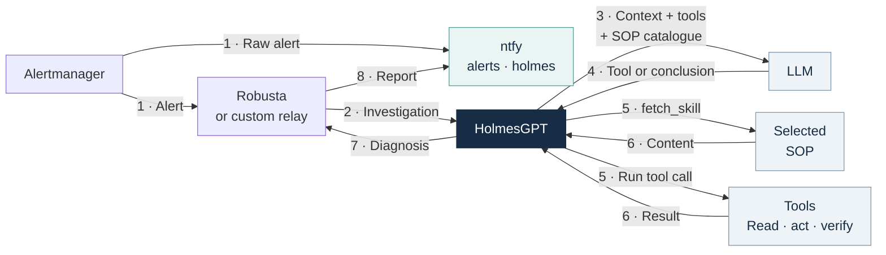
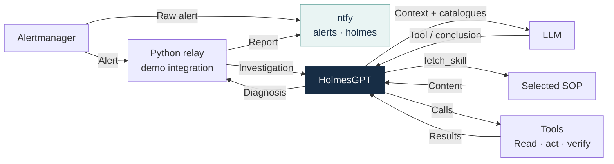
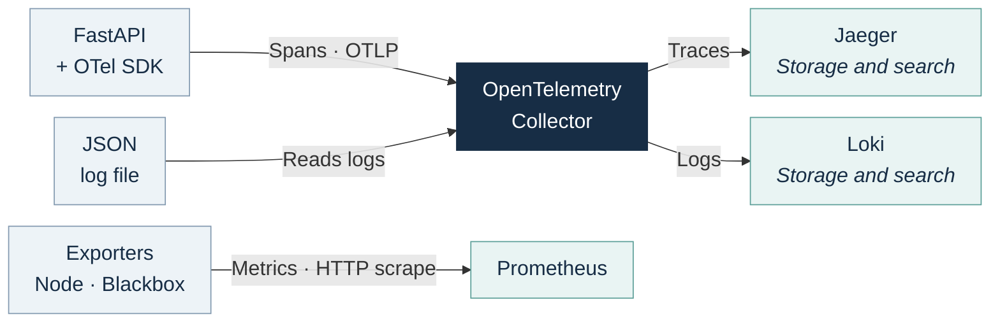
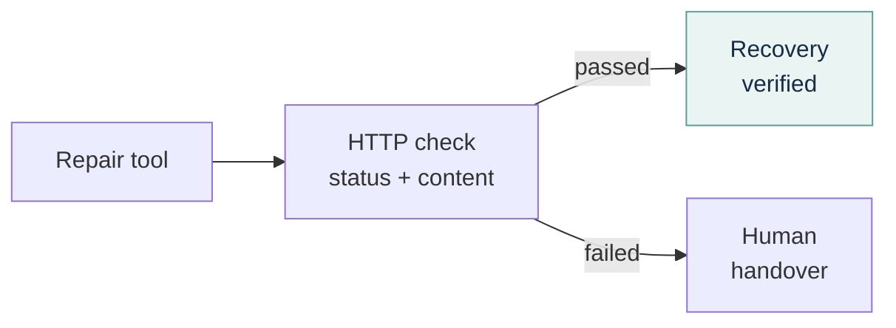
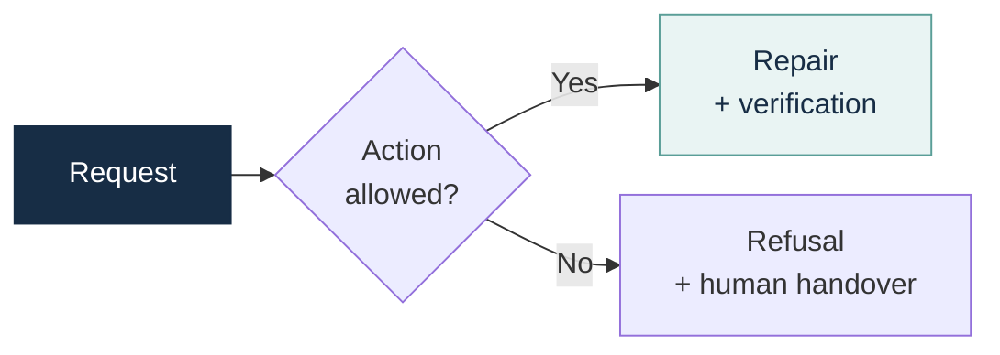
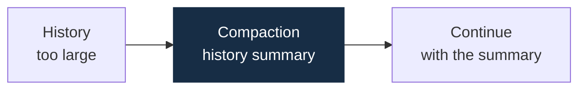
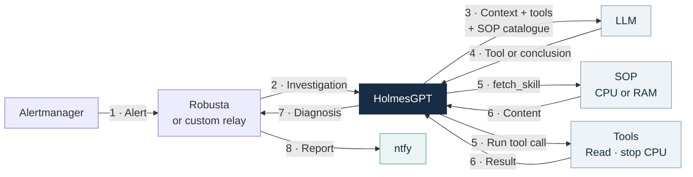

# HolmesGPT

<div class="cover-subtitle">Investigating incidents<br>Acting with clear limits</div>

<div class="cover-context">Observability for the LLM</div>

:: note ::

Cédric DELGEHIER

<!--
Introduce what Holmes promises, how we connect it to infrastructure and what our trials actually showed. The investigation engine and the model are separate components. The demo uses a disposable VM.
Sources: https://holmesgpt.dev/0.42.0/
Theme: https://github.com/gureckis/slidev-theme-neversink
-->

---
layout: default
class: chapter-slide
title: "Why HolmesGPT?"
name: besoin
routeAlias: besoin
level: 1
---

<div class="chapter-number">01</div>

# Why HolmesGPT?

<p class="chapter-lead">An alert reports a symptom. Someone still needs to choose the checks, read the results and explain what is happening before deciding what to do.</p>

<p class="chapter-question">How do we turn an alert into a clear investigation and then a controlled repair?</p>

<!--
The common question is how to move from an alert to an understandable investigation, then a controlled repair. The VM's file permission fault provides the main example.
-->

---
title: "HolmesGPT, an open source investigation agent"
name: projet
routeAlias: projet
level: 2
layout: default
class: concept-slide introduction-slide explanation-slide
---

# HolmesGPT, an open source investigation agent

<p>Originally created by <strong>Robusta.dev</strong>, HolmesGPT joined the <strong>Cloud Native Computing Foundation</strong> as a Sandbox project on <strong>8 October 2025</strong>.</p>

<p>It helps diagnose incidents through existing tools: metrics, logs, traces, service state and change history. Its scope can include Kubernetes, VMs, cloud services and databases.</p>

<p>The investigation engine and the language model are separate components. You can configure the LLM provider. The model chooses checks and interprets the results of the tools available to Holmes.</p>

<p class="takeaway">The goal is to reduce investigation work and provide an answer supported by evidence. Diagnosis time and quality need to be measured on real incidents.</p>

<!--
The CNCF confirms Sandbox acceptance on 8 October 2025. This status does not guarantee feature maturity or a correct diagnosis. Robusta.dev created the project; its repository also mentions major Microsoft contributions. Integration availability depends on version and installation.
Holmes can only consult configured sources within their data and access limits. Documented LLM providers include OpenAI, Anthropic, Azure, Bedrock and Gemini. A local model needs a compatible API and reliable tool calling.
Do not promise a universal reduction from hours to seconds. Measure investigation time, evidence quality, errors, actions and human handovers.
Sources, checked on 3 November 2026:
https://www.cncf.io/projects/holmesgpt/
https://github.com/robusta-dev/holmesgpt/blob/master/README.md
https://holmesgpt.dev/ai-providers/
-->

---
title: "What starts an investigation?"
name: declencheurs
routeAlias: declencheurs
level: 2
layout: default
class: concept-slide trigger-modes-slide explanation-slide
---

# What starts an investigation?

<p>An investigation can start with an alert, a human question, a deployment or a scheduled check.</p>

<table class="guidance-table">
  <thead><tr><th>Trigger</th><th>Example</th></tr></thead>
  <tbody>
    <tr><td>After an alert</td><td>A relay receives the alert and sends the incident context to Holmes.</td></tr>
    <tr><td>On demand</td><td>An operator asks a question through the CLI or a connected interface.</td></tr>
    <tr><td>After a deployment</td><td>Compare errors, latency and logs before and after the change.</td></tr>
    <tr><td>On a schedule</td><td>Check a specific service regularly for signs of failure.</td></tr>
  </tbody>
</table>

<p class="muted">In the demo VM, Alertmanager starts investigations through our HTTP relay.</p>

<!--
These are possible entry points, each requiring an integration. They are not all provided by the operator. In Kubernetes, the alpha Holmes operator orchestrates declared checks. Their sources can also include VMs and cloud services.
The current operator documentation describes HealthCheck for a one-time investigation, ScheduledHealthCheck for scheduled runs and TriggeredHealthCheck after a Deployment rollout. The last one watches pod template changes, not every cluster change; delay and cooldown are configurable. Scheduled checks still need questions, sources, frequencies and criteria.
The operator requires Kubernetes, but its targets do not. This VM uses only its Alertmanager relay: no operator or CRDs. A pipeline or scheduler could call the VM API, but that integration is not implemented here.
These options were checked in current documentation on 3 November 2026. Verify version support before copying resources into Holmes 0.42.0. Checks consume model calls and time; they do not guarantee detection before user impact.
Sources:
https://holmesgpt.dev/operator/
https://holmesgpt.dev/operator/health-checks/
https://holmesgpt.dev/operator/scheduled-health-checks/
https://holmesgpt.dev/operator/triggered-health-checks/
https://holmesgpt.dev/operator/deployment-verification/
https://holmesgpt.dev/0.42.0/installation/cli-installation/
-->

---
title: "What Holmes adds to an alert"
name: valeur-ajoutee
routeAlias: valeur-ajoutee
level: 2
layout: default
class: concept-slide contribution-slide explanation-slide
---

# What Holmes adds to an alert

<div class="columns concept-columns">
<div>

## The starting point

An alert saying "HTTP service unavailable" means a check failed. It does not explain whether the process stopped, a dependency failed or a file became unreadable.

Without an automated investigation, a person must select the sources, run checks, read the results and decide what to do next.

</div>
<div>

## What we expect from Holmes

Holmes reads the available metrics, system state and logs, then compares this evidence with possible causes.

If a **Standard Operating Procedure (SOP)** exists, it guides the checks and the conditions for action. Otherwise, the model chooses checks based on the alert and the available tool results.

The report should reduce the work left for the operator. A repair requires an available tool, and the request must pass its checks.

</div>
</div>

<p class="takeaway">Judge the investigation and the proposed next steps. Repeating the alert adds little value.</p>

<!--
An alert may already include context or a runbook link. Its trigger alone does not establish a root cause. Holmes adds tool reads and interpretation. Notification and repair behaviour depends on integrations and controls, not on implicit model permission.
Sources: https://holmesgpt.dev/0.42.0/ and provision/holmesGPT/assets/bridge.py.
-->

---
title: "After an alert"
name: alerte
routeAlias: alerte
level: 2
layout: default
class: triggers-slide alert-workflow-slide
---

# After an alert

<p>Holmes sends the context and catalogues to the LLM. The model requests a tool, including <code>fetch_skill</code> for an SOP, then uses its result to decide the next step.</p>

<div class="alert-diagram" data-waitfor="svg">



</div>

<p class="alert-loop-note"><strong>Loop 3–6 repeats:</strong> the loaded SOP and tool results become part of the context sent to the LLM. It can request another tool or conclude, within <code>MAX_STEPS</code>.</p>

<p class="muted">This POC uses a custom relay. ntfy topics: <code>alerts</code> for raw alerts; <code>holmes</code> for reports.</p>

<!--
Robusta is a documented integration option. This VM uses a custom Python relay; Robusta is not installed. Its standard deployment uses Helm and Kubernetes. The diagnosis returns to the integration, which publishes the report in ntfy.
The independent raw-alert path goes directly from Alertmanager to ntfy, using the alerts topic and ntfy's alertmanager template. Separately, a webhook reaches the relay and queues the investigation. The raw alert still arrives if the model fails. The relay's queue, deduplication and repair controls are custom code, not features of Holmes alone.
The numbers represent phases, not MAX_STEPS units. The two phase-1 deliveries are independent. In phase 3, Holmes sends the context to the LLM. In phase 4, the model returns a tool request or a conclusion. A fetch_skill request therefore goes from the model to Holmes. Phases 5-6 execute the requested tool and collect its result. The SOP branch details fetch_skill; the other branch represents the other tools. They need not run in the same turn.
Results enter the next context sent in phase 3. The loop continues while the model asks for tools and the budget allows it. A conclusion returns to the relay in phase 7, then ntfy in phase 8.
Context includes instructions, incident facts, tool descriptions and parameters, loaded SOPs and retained observations. Tool executables are not sent to the model. Full SOP bodies are loaded on demand, not all injected at startup. The SOP node represents files accessed through fetch_skill, not a separate service or a mandatory call in every turn.
Read tools query Prometheus, Loki, Jaeger and Linux state. Action tools expose only allowed operations. A repair needs an available tool and its permission checks. Refusal, failed checks or missing evidence require a human handover. Separate diagnosis, actual action and verified recovery in the report.
ReAct describes a cycle where observations guide subsequent tool requests. It does not expose all internal model reasoning. A turn can request several tools. In Holmes 0.42.0, tools are removed from the last planned call to request a conclusion; its quality is not guaranteed.
The POC has no question interface through ntfy. Posting there does not ask Holmes anything. The official CLI offers, for example:
holmes ask "Why is the HTTP service unavailable?"
It needs its own model and tool configuration and does not automatically connect to our server. Chat or ticket interaction requires an integration forwarding the question, context and answer.
An SOP does not schedule an investigation. This demo has no periodic investigations; do not claim proactive 24/7 monitoring for this configuration.
Sources: provision/holmesGPT/assets/bridge.py; provision/observability/monitoring.sh.
https://holmesgpt.dev/0.42.0/
https://github.com/robusta-dev/holmesgpt/blob/0.42.0/holmes/core/tool_calling_llm.py
https://holmesgpt.dev/0.42.0/installation/cli-installation/
https://github.com/HolmesGPT/holmesgpt#-end-to-end-automation
https://docs.robusta.dev/master/configuration/sinks/webhook.html
-->

---
layout: default
class: concept-slide model-decisions-slide explanation-slide
title: "Model decisions and tool limits"
name: decisions-modele
routeAlias: decisions-modele
level: 2
---

# Model decisions and tool limits

**A script could handle the known faults in this demo.** <br/>This POC shows how Holmes uses evidence and prepares the next steps for an incident.

<div class="columns concept-columns">
<div>

## The model leads the investigation

It suggests possible causes and requests checks with the available tools. The SOP describes the expected checks and the paths to follow.

It interprets results, requests an allowed action or explains why a human must take over. Its report should cite the observations that support its conclusion.

</div>
<div>

## Tools and permissions set the limits

Permissions define the accessible resources and possible actions. **Tool controls can reject a model request.**

In this demo, our Python relay takes the place of Robusta for integration. It also checks the incident, required observations and target before acting, then verifies the result.

</div>
</div>

<p class="takeaway">We assess investigation quality and the handover to humans. Repairing a known fault alone does not prove that an LLM works better than a script.</p>

<!--
The demo exposes three fixed actions. A script could automate these known cases using explicit conditions. The POC shows how an investigation agent uses observability and controlled actions; it does not measure a universal advantage over scripts.
SOPs provide checks and conditions. The model does not discover the entire procedure alone and has no arbitrary host shell. It requests available tools and interprets results.
The Python relay is custom demo code, not an official Holmes component. Its repair controls check successful observations and current state. They do not formally validate every causal statement in the model's report.
Controls include the correct active alert, action budget, cooldown and target preconditions. An SOP grants no system permission. HTTP verification is deterministic.
Sources: provision/holmesGPT/assets/bridge.py, toolsets.yaml and sops/.
-->

---
layout: default
class: chapter-slide
title: "Understanding the investigation engine"
name: moteur
routeAlias: moteur
level: 1
---

<div class="chapter-number">02</div>

# Understanding the investigation engine

<p class="chapter-lead">Holmes connects a language model to tools. The model chooses the checks, and the tools provide real observations.</p>

<p class="chapter-question">We have followed the alert. Now we look at the evidence that tools can collect.</p>

<!--
We now move from the alert workflow to the evidence available to the investigation. The VM file permission fault remains the main example.
-->

---
title: "What each source shows"
name: sources
routeAlias: sources
level: 2
layout: default
class: evidence-slide
---

# What each source shows

<table class="signal-examples-table">
  <thead><tr><th>Source</th><th>What we observe</th><th>Illustrative example</th></tr></thead>
  <tbody>
    <tr>
      <td><strong>Metrics</strong><br><span class="muted">Prometheus</span><br><span class="signal-definition">Values tracked over time</span></td>
      <td><svg class="signal-visual" viewBox="0 0 360 112" role="img" aria-label="Illustrative example: the HTTP error rate rises to 40 percent">
          <rect width="360" height="112" rx="8" fill="#101e34" />
          <text x="14" y="21" fill="#c9d8e6" style="font-size: 15px">HTTP error rate</text>
          <path d="M43 35H316 M43 60H316 M43 85H316" stroke="#34465c" stroke-width="1" />
          <path d="M43 85L97 85L151 80L205 69L259 72L313 35V85Z" fill="#43d7e8" opacity="0.12" />
          <path d="M43 85L97 85L151 80L205 69L259 72L313 35" fill="none" stroke="#43d7e8" stroke-width="3" stroke-linejoin="round" />
          <circle cx="313" cy="35" r="4" fill="#43d7e8" />
          <text x="8" y="40" fill="#c9d8e6" style="font-size: 13px">40 %</text>
          <text x="19" y="89" fill="#c9d8e6" style="font-size: 13px">0</text>
          <text x="43" y="105" fill="#c9d8e6" style="font-size: 13px">10:00</text>
          <text x="277" y="105" fill="#c9d8e6" style="font-size: 13px">10:05</text>
        </svg></td>
      <td>The error rate rises from <strong>0 to 40%</strong>.<br>We see when the service gets worse and how large the impact is.</td>
    </tr>
    <tr>
      <td><strong>Logs</strong><br><span class="muted">Loki</span><br><span class="signal-definition">Events with timestamps</span></td>
      <td><pre class="signal-log"><span class="signal-log-info">10:04:12 INFO  GET /api/check</span><br><span class="signal-log-error">10:04:12 ERROR PermissionError</span><br>read /srv/demo/message.txt</pre></td>
      <td>The log reports <strong>denied access to the file</strong>.<br>It provides the error message and its timestamp.</td>
    </tr>
    <tr>
      <td><strong>Traces</strong><br><span class="muted">Jaeger · OTel</span><br><span class="signal-definition">The operations in a request</span></td>
      <td><svg class="signal-visual" viewBox="0 0 360 112" role="img" aria-label="Illustrative example: a GET api check request contains a failed file read">
          <rect width="360" height="112" rx="8" fill="#101e34" />
          <text x="14" y="20" fill="#c9d8e6" style="font-size: 13px">0 ms</text>
          <text x="298" y="20" fill="#c9d8e6" style="font-size: 13px">50 ms</text>
          <path d="M14 25V99 M181 25V99 M346 25V99" stroke="#34465c" stroke-width="1" />
          <rect x="14" y="32" width="332" height="26" rx="3" fill="#5677a5" />
          <text x="23" y="50" fill="white" style="font-size: 15px">GET /api/check · 503</text>
          <path d="M24 59V78H45" fill="none" stroke="#c9d8e6" stroke-width="1.5" />
          <rect x="45" y="65" width="273" height="26" rx="3" fill="#a74357" />
          <text x="54" y="83" fill="white" style="font-size: 15px">read message.txt · error</text>
        </svg></td>
      <td>The request fails while <strong>reading the file</strong>.<br>We connect the error to its operation, duration and parent request.</td>
    </tr>
  </tbody>
</table>

<p class="signal-state-note"><strong>Current state:</strong> systemd service state, Linux mounts and permissions, or pod status from the Kubernetes API.</p>

<!--
These are illustrative examples, not captured demo results. Values, timestamps and durations are invented for explanation. The metric curve, log extract and span waterfall are native Slidev visuals; no pixels from the reference image are reused.
A trace shows instrumented application operations and parent-child links, not every system call as strace would. Both spans shown have an error status; their durations do not come from Jaeger.
Metrics are time series such as error rate, CPU, memory and latency. They show trends or impact, but cannot alone explain an error. Logs describe timestamped events with available fields. Loki stores and queries logs. Traces group spans: operations with timing, attributes and possible errors. OpenTelemetry provides instrumentation and transport; Jaeger stores and queries traces. Coverage depends on instrumentation and sampling.
Kubernetes state is a separate example, not part of this Linux VM. Its API exposes desired configuration, observed state and events with limited retention. OOMKilled can describe a container's last termination; metrics help examine prior memory pressure. CrashLoopBackOff describes repeated failed starts, not their cause. Linux systemd, mount and permission reads provide current system state for this demo.
References:
https://prometheus.io/docs/concepts/data_model/
https://grafana.com/docs/loki/latest/get-started/overview/
https://opentelemetry.io/docs/concepts/signals/traces/
https://kubernetes.io/docs/concepts/overview/working-with-objects/
https://kubernetes.io/docs/concepts/workloads/pods/pod-lifecycle/
-->

---
layout: default
class: chapter-slide
title: "Building the demo environment"
name: environnement
routeAlias: environnement
level: 1
---

<div class="chapter-number">03</div>

# Building the demo environment

<p class="chapter-lead">A Linux VM runs an HTTP service, observability collection and the relay to Holmes. An API provides access to the model server.</p>

<p class="chapter-question">The demo follows the application, observations, alert, investigation and report.</p>

<!--
Introduce the Linux VM setup before following one incident. The application, collection, alerting, investigation and reporting paths each have a separate role.
-->

---
title: "The VM connects the application, evidence and Holmes"
routeAlias: architecture-vm
layout: default
class: concept-slide vm-architecture-slide explanation-slide
name: architecture-vm
level: 2
---

# The VM connects the application, evidence and Holmes

<p><a href="https://fastapi.tiangolo.com/" target="_blank" rel="noopener noreferrer">FastAPI</a> serves the home page and <code>/api/check</code>, which reads the demo file.</p>

<p class="architecture-stack"><strong>Observability:</strong> <a href="https://prometheus.io/docs/introduction/overview/" target="_blank" rel="noopener noreferrer">Prometheus</a>, <a href="https://prometheus.io/docs/alerting/latest/alertmanager/" target="_blank" rel="noopener noreferrer">Alertmanager</a>, <a href="https://github.com/prometheus/blackbox_exporter" target="_blank" rel="noopener noreferrer">Blackbox Exporter</a>, <a href="https://github.com/prometheus/node_exporter" target="_blank" rel="noopener noreferrer">Node Exporter</a>, <a href="https://opentelemetry.io/docs/collector/" target="_blank" rel="noopener noreferrer">OpenTelemetry Collector</a>, <a href="https://www.jaegertracing.io/docs/latest/" target="_blank" rel="noopener noreferrer">Jaeger</a>, <a href="https://grafana.com/docs/loki/latest/" target="_blank" rel="noopener noreferrer">Loki</a> and <a href="https://grafana.com/docs/grafana/latest/" target="_blank" rel="noopener noreferrer">Grafana</a>.</p>

<div data-waitfor="svg">



</div>

<p>Tools query Prometheus, Loki, Jaeger and Linux state. <a href="https://grafana.com/docs/grafana/latest/" target="_blank" rel="noopener noreferrer">Grafana</a> lets people explore these signals. Holmes returns the diagnosis to the relay, which publishes it in <a href="https://docs.ntfy.sh/" target="_blank" rel="noopener noreferrer">ntfy</a>.</p>

<!--
This is a logical view of the existing setup, not an added installation. demo-fastapi starts Uvicorn and the FastAPI application. One process serves / and /api/check, with no reverse proxy. The home page does not read the file and stays available if that dependency fails.
Blackbox Exporter probes the service; Prometheus scrapes its metrics and Node Exporter. FastAPI pushes spans over OTLP/HTTP and writes JSON logs to a file. The Collector reads the logs, sends them to Loki and sends traces to Jaeger. There is no Prometheus-to-Loki flow.
The diagram follows the alert workflow: Alertmanager calls the relay, which calls Holmes; diagnosis returns to the relay for publication. Raw alerts go directly to ntfy. Loaded SOPs and tool results enter the next model context. Tools query sources; evidence is not pushed into Holmes automatically.
Diagram and component links open documentation. The custom relay links to the slide explaining its role. Mermaid securityLevel loose applies only to this locally authored diagram to enable explicit links.
systemd manages the Holmes container and Python relay. This is not a Kubernetes cluster. Neither Robusta nor the Holmes operator is installed. The model is a separate service reached through an OpenAI-compatible API. Grafana is for human exploration; Holmes uses tools to read sources.
FastAPI instrumentation automatically creates the HTTP span; application code adds a child span for the file read. ASGI send/receive spans are excluded for clarity. This view makes no performance claims.
Sources: provision/observability/fastapi.sh, assets/fastapi_app.py, monitoring.sh, telemetry.sh; provision/holmesGPT/install.sh and assets/toolsets.yaml.
-->

---
title: "Logs and traces: two views of a request"
name: logs-et-traces
routeAlias: logs-et-traces
level: 2
layout: default
class: concept-slide logs-traces-slide explanation-slide
---

# Logs and traces: two views of a request

<div class="columns concept-columns">
<div>

## A log describes an event

The FastAPI application writes an event with a timestamp, message, level and fields. Here, it explains why the file read failed.

```json
{
  "message": "Demo file cannot be read",
  "error_type": "PermissionError",
  "trace_id": "…"
}
```

This message can be very precise. It does not automatically describe every operation in the request or the links between them.

</div>
<div>

## A trace shows the request path

A trace contains <strong>spans</strong>. A span represents an operation with a start, an end, a status and an optional parent.

<div class="trace-spans-example">
<svg class="signal-visual" viewBox="0 0 360 112" role="img" aria-label="Illustrative example: a GET api check request contains a failed file read">
  <rect width="360" height="112" rx="8" fill="#101e34" />
  <text x="14" y="20" fill="#c9d8e6" style="font-size: 13px">0 ms</text>
  <text x="298" y="20" fill="#c9d8e6" style="font-size: 13px">50 ms</text>
  <path d="M14 25V99 M181 25V99 M346 25V99" stroke="#34465c" stroke-width="1" />
  <rect x="14" y="32" width="332" height="26" rx="3" fill="#5677a5" />
  <text x="23" y="50" fill="white" style="font-size: 15px">GET /api/check · 503</text>
  <path d="M24 59V78H45" fill="none" stroke="#c9d8e6" stroke-width="1.5" />
  <rect x="45" y="65" width="273" height="26" rx="3" fill="#a74357" />
  <text x="54" y="83" fill="white" style="font-size: 15px">read message.txt · error</text>
</svg>
</div>

The HTTP bar is the **parent span**. The file read is its **child span**. The trace shows where the operation failed within the request.

</div>
</div>

<p class="takeaway">A shared <code>trace_id</code> connects the detailed log to the request trace.</p>

<!--
The extracts are shortened illustrations. The waterfall reuses the metrics/logs/traces slide: a parent HTTP span and child file-read span. Durations are illustrative. They share a trace_id, but have different span_id values. A trace can cover multiple services if context is propagated.
The actual FastAPI JSON log also has timestamp, service, level, route, status and span_id. A real trace_id is a complete hexadecimal identifier, not an ellipsis.
Logs can be structured, contain request IDs and record durations. The distinction is not text versus structured data, nor errors versus success. A span explicitly records an operation, duration and relation to other spans. A log records an event. Both can describe successful or failed requests.
FastAPI instrumentation creates the SERVER GET /api/check span. Application code adds read demo message. The child span context records the read exception; the parent receives ERROR status and error.type. The JSON log carries the trace_id and parent HTTP span_id. A trace is useful even within one service.
Sources: provision/observability/assets/fastapi_app.py and telemetry.sh.
https://opentelemetry.io/docs/concepts/signals/traces/
https://www.stephane-robert.info/docs/observabilite/fondamentaux/signaux/logs/
-->

---
title: "From signals to observability backends"
name: collecte-traces
routeAlias: collecte-traces
level: 2
layout: default
class: concept-slide trace-export-slide explanation-slide
---

# From signals to observability backends

<div class="telemetry-code-row">
<div>

```python
with tracer.start_as_current_span("read demo message"):
    message = message_file.read()
```

</div>
<p>FastAPI instrumentation creates the HTTP span. This code adds a <strong>child span</strong>. The SDK exports spans in the background.</p>
</div>

<div data-waitfor="svg">



</div>

<p class="telemetry-roles">The Collector reads JSON logs and the systemd journal. <strong>Prometheus scrapes exporters:</strong> Node Exporter measures the host, and Blackbox Exporter probes FastAPI.</p>

<!--
This matches the VM scripts. FastAPI configures TracerProvider, BatchSpanProcessor and an HTTP OTLPSpanExporter. Export is asynchronous, with a 500 ms batch delay here. The Collector uses memory_limiter and batch before OTLP/HTTP export to Jaeger.
The SDK pushes spans; Prometheus does not scrape them and Jaeger does not read the code or log files. The logs/fastapi pipeline reads requests.jsonl with file_log and json_parser, then exports to Loki's OTLP endpoint. The logs/linux pipeline reads systemd using the journald receiver and also exports to Loki. Loki ingests, stores and queries logs; it does not read VM files. No Promtail is used.
Arrows represent data flow. The Collector actively reads files and the journal. Prometheus actively initiates HTTP scrapes. Node Exporter exposes CPU, memory, disks and systemd; Blackbox probes / and /api/check. These metrics do not pass through the Collector. Prometheus also scrapes internal stack metrics, omitted here. FastAPI exposes no /metrics route in this demo.
A separate Collector is optional for traces: Jaeger also accepts OTLP directly. Here it handles both logs and traces with batching and a memory limiter. Do not claim extra sensitive-data masking is configured.
FastAPIInstrumentor.instrument_app adds HTTP method, route, status and duration. It extracts incoming traceparent or starts a new trace. Application code adds read demo message because the framework does not know this business operation. A Collector cannot observe an operation without instrumentation.
Distributed tracing needs context propagation between services, usually traceparent. The file span keeps the HTTP context even in the synchronous handler's thread. Collection also depends on sampling and successful export.
Sources: provision/observability/assets/fastapi_app.py, fastapi.sh, telemetry.sh and monitoring.sh.
https://opentelemetry.io/docs/languages/python/instrumentation/
https://opentelemetry.io/docs/collector/
https://grafana.com/docs/loki/latest/send-data/otel/
https://prometheus.io/docs/introduction/overview/
-->

---
layout: default
class: chapter-slide
title: "Following an investigation"
name: incident
routeAlias: incident
level: 1
---

<div class="chapter-number">04</div>

# Following an investigation

<p class="chapter-lead">The HTTP probe fails while FastAPI is still running. We follow a file read error from the first symptom to the result of the intervention.</p>

<p class="chapter-question">What evidence allows a repair, and which checks confirm that the service has recovered?</p>

<!--
Follow the permission fault from the HTTP symptom to the supporting evidence, allowed repair and verification. The live missing-file scenario later has a different outcome.
-->

---
title: "The probe fails while the process keeps running"
routeAlias: panne-permissions
layout: default
class: concept-slide incident-start-slide explanation-slide
name: panne-permissions
level: 2
---

# The probe fails while the process keeps running

<p>In the demo, FastAPI reads <code>/srv/demo/message.txt</code> to answer the request. We remove read permissions without stopping the process.</p>

```bash
# Inside the VM
sudo chmod 000 /srv/demo/message.txt
```

<p>FastAPI stays active and serves its home page, but <code>/api/check</code> now returns HTTP 503. Its <strong>log</strong> reports <code>PermissionError</code>, and its <strong>trace</strong> shows the failed file read. Prometheus detects the failed probe, then Alertmanager sends the alert to the relay.</p>

<p class="takeaway">The alert reports an HTTP failure. The investigation still needs to check whether the process stopped or a file permission needs to change.</p>

<!--
This describes expected behaviour from the code, not a captured live run. No fault was injected to create the slide. Run only inside the Labstack VM. demo-fastapi runs as www-data and cannot read a mode-000 file. The home page stays available; DemoApiUnavailable is the relevant alert. Finish one investigation before injecting another fault.
Manual recovery inside the VM:
sudo chmod 0644 /srv/demo/message.txt
Alert delays are shortened for the demo. Inference adds its own latency. The live demo slide contains the three main scenarios.
Sources: provision/observability/assets/fastapi_app.py, monitoring.sh; provision/holmesGPT/assets/sops/file-permissions/SKILL.md.
-->

---
title: "From evidence to Holmes' decisions"
name: preuves-http
routeAlias: preuves-http
level: 2
layout: default
class: concept-slide evidence-correlation-slide explanation-slide
---

# From evidence to Holmes' decisions

<p>Each observation helps test a possible cause and choose the next check.</p>

<table class="guidance-table evidence-decisions-table">
  <thead><tr><th>Evidence collected</th><th>What Holmes can conclude</th><th>Next check</th></tr></thead>
  <tbody>
    <tr><td>Probe: HTTP <code>503</code></td><td>The service responds, but request processing fails.</td><td>Find the failed operation in the trace.</td></tr>
    <tr><td>Failed <code>read demo message</code> span</td><td>The file read fails. Its cause still needs checking.</td><td>Read the log with the same <code>trace_id</code>.</td></tr>
    <tr><td>Log: <code>PermissionError</code></td><td>The service cannot access the file.</td><td>Check the file, mount and service user.</td></tr>
    <tr><td>File exists, mode <code>000</code>, mount and service active</td><td>The service cannot read the file.</td><td>Check the SOP and the allowed repair tool.</td></tr>
  </tbody>
</table>

<p class="takeaway">Conclusion: a permissions fault. The SOP and the tool define the repair conditions.</p>

<!--
This is an illustrative permissions investigation, not a captured model response or required collection order. The table shows conclusions justified by observations, not the model's private internal reasoning. Holmes may group reads or use a different order. It may load the SOP early; the final row recalls action preconditions, not a required late load.
The probe fails on an HTTP error although the process runs. The trace locates the failed read; the JSON log gives PermissionError and the same trace_id. System state confirms a regular file with mode 000. The unprivileged FastAPI user cannot read it.
The probe alone cannot distinguish a stopped service, a dependency error or permissions. A missing file or mount requires a different hypothesis and blocks the permission repair.
The VM uses read_demo_metrics, read_demo_traces, read_demo_logs and read_demo_status, not Kubernetes. Gathering evidence does not grant permission to act.
Sources: provision/observability/assets/fastapi_app.py; provision/holmesGPT/assets/toolsets.yaml and bridge.py.
-->

---
title: "A successful action still needs a recovery check"
name: verification
routeAlias: verification
level: 2
layout: default
class: concept-slide verification-slide explanation-slide
---

# A successful action still needs a recovery check

<p>A command may succeed while the incident continues. A process can start with an unavailable dependency or return the wrong HTTP content. After the action, we still need to check the service.</p>

<div data-waitfor="svg">



</div>

<p>In the demo, the repair tool sends a new request and checks <strong>HTTP 200 and the expected content</strong>. If this check fails, Holmes should report "action completed, recovery unconfirmed" instead of declaring the incident resolved.</p>

<!--
The repair tool independently checks the HTTP response after starting the service or restoring permissions. It checks expected content, not just status or process state. The model's report does not replace this check. Failed verification cannot establish recovery and does not trigger a new automatic repair attempt.
Sources: provision/holmesGPT/assets/bridge.py and tests/holmes.sh.
-->

---
layout: default
class: chapter-slide
title: "Controlling the agent"
name: maitrise
routeAlias: maitrise
level: 1
---

<div class="chapter-number">05</div>

# Controlling the agent

<p class="chapter-lead">We have seen one possible repair. We still need to define when it is allowed, when the agent must stop and which resources its investigation can use.</p>

<p class="chapter-question">The SOP guides decisions. Tools and permissions enforce the limits.</p>

<!--
Move from an example repair to the general controls: evidence, permissions, stop conditions and investigation resources. The SOP guides decisions; tools enforce limits.
-->

---
title: "Inside an SOP: defining the investigation"
name: sop-enquete
routeAlias: sop-enquete
level: 2
layout: default
class: concept-slide sop-content-slide explanation-slide
---

# Inside an SOP: defining the investigation

<p>An SOP should help Holmes recognise the right incident, choose useful checks and understand what their results can prove.</p>

<table class="guidance-table">
  <thead><tr><th>What to define</th><th>Example for an HTTP service</th></tr></thead>
  <tbody>
    <tr><td>Trigger and scope</td><td>Alert name, target service and environment, owner and exceptions such as planned maintenance.</td></tr>
    <tr><td>Expected behaviour</td><td>HTTP 200 and the expected content. A running process alone does not prove that the service is healthy.</td></tr>
    <tr><td>Possible causes and evidence</td><td>Which checks separate a stopped service, a failed dependency and an unreadable file? What is still unknown?</td></tr>
    <tr><td>Tools and collection</td><td>Name the tools, time window and useful fields. Limit data volume while keeping errors visible.</td></tr>
  </tbody>
</table>

<!--
This recommended outline applies the course material to a Holmes SOP. Name and description should allow selection. Also record an owner, version and review date in team documentation or metadata.
Define prerequisites, dependencies and exceptions such as maintenance, an intentionally stopped service or an excluded environment. Use trusted sources, not invented model assumptions. No maintenance-calendar mechanism is added to the VM here.
Name checks that separate possible causes, with their tool and the meaning of the result. A useful first check is better than an exhaustive list of every cause. Add a successful case and a refusal case when useful; avoid an encyclopaedia of exceptions.
Course sources: claude_ccar-p/docs/cours/07-productivite-exploitation.md, sections 7-9; docs/cours/02-modeles-prompting-contexte.md, section 3; docs/cours/03-integration.md, section 2.
-->

---
title: "Example: an SOP for the HTTP service"
name: sop-fichier
routeAlias: sop-fichier
level: 2
layout: default
class: sop-slide
---

# Example: an SOP for the HTTP service

<div class="columns sop-columns">
<div>

```markdown
---
name: demo-http-service
description: Diagnose DemoHttpUnavailable.
---
1. Read status, metrics and logs.
2. Confirm: failed probe AND stopped service.
3. Call start_demo_fastapi once if allowed.
4. Report the verified HTTP result.
```

<p class="muted">Shortened extract from the HTTP service SOP</p>

<p class="sop-guidance">Keep the SOP in version control. Test it on a fault and on a case where the tool must refuse the action.</p>

</div>
<div class="sop-guidance">

## One SOP, one file

```text
sops/
├── http-service/SKILL.md
├── file-permissions/SKILL.md
├── cpu-pressure/SKILL.md
├── memory-pressure/SKILL.md
├── disk-space/SKILL.md
├── missing-mount/SKILL.md
└── monitoring/SKILL.md
```

The name and description guide selection. The body defines evidence, allowed actions and when to ask a human.

</div>
</div>

<p class="takeaway">Robusta or our relay forwards the alert. <strong>The model selects an SOP from the Holmes catalogue and requests <code>fetch_skill</code></strong>, using its name and description.</p>

<!--
The extract is a shortened version of the VM's HTTP SOP, not its exact file. The real SOP requires matching the probe, systemd state and logs. It forbids restarting other services or retrying a refused action.
build_prompt passes incident labels and asks the model to choose from the native Holmes catalogue without imposing an SOP name. Descriptions guide selection; they are not Alertmanager routing rules. Repair controls still use the alert name. An SOP description grants no permissions.
Robusta can receive alerts, trigger Holmes and forward results through configured playbooks and sinks. This does not mean it automatically provides the demo relay's custom repair checks. Robusta is not installed here and need not know SOP files to call Holmes.
Configured SOP names and descriptions enter the catalogue. The model selects a relevant one and requests fetch_skill. Without a suitable SOP it can investigate using available reads, report the gap and request help. It must not invent a repair. Our relay has no alert-to-SOP routing table.
custom_skill_paths points to the local SOP directory. Provisioning copies provision/holmesGPT/assets/sops/ to /etc/labstack-holmes/sops and mounts it read-only at /etc/holmes/sops in the container. SOPs are always available and loaded as needed.
Sources: provision/holmesGPT/assets/sops/http-service/SKILL.md, render_config.py and bridge.py.
https://github.com/HolmesGPT/holmesgpt#-end-to-end-automation
https://docs.robusta.dev/master/configuration/sinks/webhook.html
-->

---
title: "Permission to act is explicit"
name: autorisations
routeAlias: autorisations
level: 2
layout: default
class: actions-slide explanation-slide
---

# Permission to act is explicit

<div class="columns action-columns">
<div>

**The SOP guides the investigation**<br>
Holmes loads the incident procedure: required evidence, repair conditions and cases that need a human. The SOP grants no system permissions.

</div>
<div>

**Tools limit the available actions**<br>
Three fixed actions are available: start the HTTP service, restore file permissions or stop the identified CPU stress job. The repair tool checks each request. Memory pressure needs human intervention.

</div>
</div>

<div class="action-diagram" data-waitfor="svg">



</div>

<p class="muted">The repair tool requires an active incident, the expected evidence and the exact target. It limits attempts and verifies recovery. A refusal or failure requires a human handover.</p>

<!--
No mode switch is needed. SOPs are always available; repair tools independently check action requests.
The VM permits starting demo-fastapi, changing the regular file /srv/demo/message.txt from 000 to 0644, and stopping the identified labstack-demo-cpu job. The first two actions verify HTTP content; the third verifies reduced CPU and alert resolution. Holmes cannot stop the RAM stress or kill an arbitrary PID.
A one-minute global cooldown separates repair attempts. A persistent journal prevents repeating a mutation after restart. Holmes has neither a host shell nor a Docker socket. The Python relay has only the required action permissions; the SOP is not an access barrier.
Sources: provision/holmesGPT/README.md and assets/bridge.py.
-->

---
title: "An SOP guides checks and refusals to act"
name: sop-refus
routeAlias: sop-refus
level: 2
layout: default
class: concept-slide sop-branches-slide explanation-slide
---

# An SOP guides checks and refusals to act

<p>The SOP explains which checks to run, when to change direction and when to refuse an action.</p>

<table class="guidance-table">
  <thead><tr><th>Observation</th><th>Decision described in the SOP</th></tr></thead>
  <tbody>
    <tr><td>API responds with <code>PermissionError</code></td><td>Check the file, mount and permissions before DNS or networking. Evidence supports this priority.</td></tr>
    <tr><td>Missing file or mount, or conflicting evidence</td><td>Leave the permissions procedure and review the possible cause. Another SOP may fit better.</td></tr>
    <tr><td>Unavailable tool, unknown conditions or refused action</td><td>Hand over with the evidence and missing checks. Do not force an action or expand permissions.</td></tr>
  </tbody>
</table>

<p class="takeaway">After an action, check recovery. A failed check needs a report and human intervention.</p>

<!--
The slide combines evidence-based priorities and refusal conditions. It uses the FastAPI file example; it does not add native orchestration or install another procedure. The SOP guides the model; tools enforce preconditions and budgets.
A reachable API and PermissionError prioritise file, mount and permission checks over DNS or networking. Conflicting evidence can reopen those possibilities. Unrelated reads cost time and context.
A missing mount cannot be repaired by changing the permissions of the directory underneath. A missing file cannot be recreated with chmod. Leaving an SOP means choosing another relevant procedure or handing over, without inventing a broader action.
Even with a confirmed fault, an absent tool, unknown precondition or refusal requires human intervention. Failed recovery does not allow another mutation or wider privileges. Reports retain evidence, missing checks, expected human intervention and failed reads.
Test the normal path, conflicting or missing evidence, out-of-scope cases, unavailable tools, refusals and unconfirmed recovery.
The exclusion principle draws on Sathish Mohanram's presentation. Its reduction figures are not lab measurements or guaranteed savings. Model turns and tool calls are different counters.
Sources: provision/holmesGPT/assets/sops/http-service/SKILL.md, sops/file-permissions/SKILL.md and bridge.py.
https://prezi.com/page/tcg-k2ujr-yd/sre-alert-automation-with-holmesgpt-robusta
Course sources: claude_ccar-p/docs/cours/07-productivite-exploitation.md, sections 8-9; docs/cours/05-gouvernance-securite-risques.md, section 5.
-->

---
title: "Inside an SOP: act, verify or hand over"
name: sop-actions
routeAlias: sop-actions
level: 2
layout: default
class: concept-slide sop-decisions-slide explanation-slide
---

# Inside an SOP: act, verify or hand over

<p>The procedure should define success and when the investigation stops. "Repair if needed" gives neither clear permission nor a recovery check.</p>

<table class="guidance-table">
  <thead><tr><th>What to define</th><th>Expected decision</th></tr></thead>
  <tbody>
    <tr><td>Conditions for action</td><td>Define the required evidence, exact target and allowed tool before any change.</td></tr>
    <tr><td>Limits and fallback</td><td>Set the maximum attempts and the response to a refusal or failure. Do not expand permissions during the incident.</td></tr>
    <tr><td>Recovery</td><td>Repeat the health check after the action: HTTP status and expected content, beyond the command exit status.</td></tr>
    <tr><td>Stopping and reporting</td><td>If unsure or making no progress, send facts, actions, unknowns and the next check to a named owner.</td></tr>
  </tbody>
</table>

<!--
A probabilistic instruction is different from a deterministic control. Permissions and validation must hold even when the model does not follow an SOP. Model confidence is not an action precondition; use observable evidence.
Define the exact action, forbidden effects, attempt count and recovery check. If rollback is needed, describe, authorise and test it. Do not invent a rollback for an example. This VM tries a repair once; refusal or failure does not permit a different command or wider privileges.
Handover should name an owner or destination and include evidence, actual actions, results and the next check. Distinguish facts, possible causes and confirmed recovery. Version SOPs and exercise success, refusal and missing-data paths. These are design recommendations, not new VM changes.
Course sources: claude_ccar-p/docs/cours/05-gouvernance-securite-risques.md, sections 3 and 5; docs/cours/07-productivite-exploitation.md, section 9.
Application: provision/holmesGPT/assets/sops/http-service/SKILL.md and bridge.py.
-->

---
layout: default
class: chapter-slide
title: "Why an investigation fails"
name: ressources-enquete
routeAlias: ressources-enquete
level: 1
---

<div class="chapter-number">06</div>

# Why an investigation fails

<p class="chapter-lead">The model depends on the observations it receives and the available resources. An investigation can stop because tools fail, context grows too large or memory runs out.</p>

<p class="chapter-question">Our observed failures help explain the limits for steps, tokens and memory.</p>

<!--
Separate model limitations, tool errors, context budgets and memory limits. Historical cases explain why we changed settings. The VM uses current values; the kubectl test comes from a different Kubernetes integration. The following symptoms are checks to pursue, not automatic diagnoses.
-->

---
layout: default
class: concept-slide investigation-triage-slide explanation-slide
title: "When an investigation runs without a conclusion"
name: diagnostic-enquete
routeAlias: diagnostic-enquete
level: 2
---

# When an investigation runs without a conclusion

<p>An incomplete investigation can have several causes. Before changing the model or increasing a limit, find the first failure in the tool calls and their results.</p>

<table class="guidance-table triage-table">
  <thead><tr><th>Symptom</th><th>What to check</th><th>Useful evidence</th></tr></thead>
  <tbody>
    <tr><td>Turn limit reached</td><td>The investigation covers too much, or repeats checks without progress.</td><td>Timeline of calls and remaining possible causes.</td></tr>
    <tr><td>Context too large</td><td>Long logs, crowded history or repeated compaction.</td><td>Input size, filters and summaries sent to the model.</td></tr>
  </tbody>
</table>

<p>Repeated checks may come from an unclear question, an unusable result or information lost from the history. The call timeline helps identify what needs fixing.</p>

<p class="takeaway">The turn limit bounds investigation cycles. Context size bounds the information available at each cycle.</p>

<!--
A symptom can have several causes. Repeated checks may come from the model, SOP or unusable results. A timeout alone does not establish an OOM.
Historical investigations reached their turn limit while some tools also failed. An isolated kubectl test later checked its virtual memory limit. Do not attribute all improvement to one change.
Course source: claude_ccar-p/docs/cours/04-evaluation-testing-optimisation.md, layered diagnosis and measured optimisation. Evidence is described in the essais-etapes and memoire-outils notes.
-->

---
title: "Why limit investigation turns?"
name: essais-etapes
routeAlias: essais-etapes
level: 2
layout: default
class: concept-slide steps-budget-slide explanation-slide
---

# Why limit investigation turns?

<div class="columns concept-columns">
<div>

## A configurable limit

`MAX_STEPS` limits investigation turns. One turn can request several tools. Each check should add new evidence or verify a change.

**Our first trials used a limit of 8.** This is not a universal Holmes rule.

The demo allows **12 turns**. This leaves room for several checks. It is neither a guarantee of success nor a target to reach.

</div>
<div>

## What we observed

A broad investigation used all **8 turns** without a useful diagnosis.

Increasing the limit to **16 turns** was not enough. Some tools failed and returned too much text.

Focused questions and bounded reads later produced useful reports. We needed usable observations as well as enough turns.

</div>
</div>

<p class="takeaway">A larger budget cannot fix a failing tool or an investigation with an unclear scope.</p>

<!--
Eight and sixteen refer to earlier trials, not the current VM. The eight-turn run executed 21 tool calls, so turns do not count commands. The sixteen-turn replay also failed. Procedures, tool limits and context changed later; do not credit one setting alone.
MAX_STEPS bounds turns, not total time. Model calls and tools have their own duration or timeout. A repeated read can be useful after a change. Without progress or at the limit, report established facts, unknowns and the next human check. In 0.42.0, tools are removed from the final planned call to request a conclusion.
Course sources: claude_ccar-p/docs/cours/01-solution-design-architecture.md, section 4; docs/cours/02-modeles-prompting-contexte.md, section 3; docs/cours/04-evaluation-testing-optimisation.md, sections 7-8.
Demo configuration: provision/holmesGPT/install.sh, MAX_STEPS=12.
-->

---
title: "Planning the context budget"
name: repartition-contexte
routeAlias: repartition-contexte
level: 2
layout: default
class: concept-slide budgets-slide explanation-slide
---

# Planning the context budget

<p>At each call, Holmes sends the instructions, tool descriptions and useful history to the model. The model works with this content. It has no automatic long-term memory of the incident.</p>

<div class="context-tube-layout">
<svg class="context-tube" viewBox="0 0 260 380" role="img" aria-labelledby="context-tube-title context-tube-desc">
  <title id="context-tube-title">Illustrative allocation of a 20,480-token context</title>
  <desc id="context-tube-desc">Instructions, SOPs and tools: 15%. Question and facts: 5%. History and results: 50%. Headroom: 10%. Output reserve: 20%. Segment height is proportional to the budget.</desc>
  <defs>
    <linearGradient id="context-tube-instructions" x1="0" x2="1">
      <stop offset="0" stop-color="#91bdd8" />
      <stop offset="0.25" stop-color="#347da8" />
      <stop offset="0.6" stop-color="#205577" />
      <stop offset="1" stop-color="#91bdd8" />
    </linearGradient>
    <linearGradient id="context-tube-incident" x1="0" x2="1">
      <stop offset="0" stop-color="#e8c68a" />
      <stop offset="0.25" stop-color="#c38b37" />
      <stop offset="0.6" stop-color="#8e5e20" />
      <stop offset="1" stop-color="#e8c68a" />
    </linearGradient>
    <linearGradient id="context-tube-history" x1="0" x2="1">
      <stop offset="0" stop-color="#85c1b6" />
      <stop offset="0.25" stop-color="#24877d" />
      <stop offset="0.6" stop-color="#145c56" />
      <stop offset="1" stop-color="#85c1b6" />
    </linearGradient>
    <linearGradient id="context-tube-margin" x1="0" x2="1">
      <stop offset="0" stop-color="#c1ccda" />
      <stop offset="0.25" stop-color="#7c8fa3" />
      <stop offset="0.6" stop-color="#4c6076" />
      <stop offset="1" stop-color="#c1ccda" />
    </linearGradient>
    <linearGradient id="context-tube-output" x1="0" x2="1">
      <stop offset="0" stop-color="#b0a2ce" />
      <stop offset="0.25" stop-color="#655494" />
      <stop offset="0.6" stop-color="#43356c" />
      <stop offset="1" stop-color="#b0a2ce" />
    </linearGradient>
  </defs>
  <ellipse cx="124" cy="370" rx="82" ry="7" fill="#172d45" opacity="0.08" />
  <path d="M46 26 C46 44 202 44 202 26 L202 74 C202 92 46 92 46 74 Z" fill="url(#context-tube-instructions)" />
  <path d="M46 74 C46 92 202 92 202 74 L202 90 C202 108 46 108 46 90 Z" fill="url(#context-tube-incident)" />
  <path d="M46 90 C46 108 202 108 202 90 L202 250 C202 268 46 268 46 250 Z" fill="url(#context-tube-history)" />
  <path d="M46 250 C46 268 202 268 202 250 L202 282 C202 300 46 300 46 282 Z" fill="url(#context-tube-margin)" />
  <path d="M46 282 C46 300 202 300 202 282 L202 346 C202 364 46 364 46 346 Z" fill="url(#context-tube-output)" />
  <ellipse cx="124" cy="26" rx="78" ry="14" fill="#91bdd8" stroke="#c6deed" stroke-width="1.5" />
  <text x="124" y="188" text-anchor="middle" fill="white" style="font-size: 30px; font-weight: 600">50 %</text>
</svg>
<div class="context-budget-legend">
<div class="context-budget-item">
<span class="context-budget-marker" style="background: #347da8" aria-hidden="true"></span>
<span>Instructions, SOPs and tool descriptions</span>
<span class="context-budget-value"><strong>3,072</strong> tokens<span>15% of context</span></span>
</div>
<div class="context-budget-item">
<span class="context-budget-marker" style="background: #c38b37" aria-hidden="true"></span>
<span>Question and incident facts</span>
<span class="context-budget-value"><strong>1,024</strong> tokens<span>5% of context</span></span>
</div>
<div class="context-budget-item">
<span class="context-budget-marker" style="background: #24877d" aria-hidden="true"></span>
<span>Useful history and tool results</span>
<span class="context-budget-value"><strong>10,240</strong> tokens<span>50% of context</span></span>
</div>
<div class="context-budget-item">
<span class="context-budget-marker" style="background: #7c8fa3" aria-hidden="true"></span>
<span>Headroom for input variation</span>
<span class="context-budget-value"><strong>2,048</strong> tokens<span>10% of context</span></span>
</div>
<div class="context-budget-item">
<span class="context-budget-marker" style="background: #655494" aria-hidden="true"></span>
<span>Output reserve</span>
<span class="context-budget-value"><strong>4,096</strong> tokens<span>20% of context</span></span>
</div>
</div>
</div>

<p class="muted context-budget-note">Total budget: <code>max_context_size: 20480</code>. <code>max_tokens: 4096</code> applies per call, not to the whole investigation. Input shares are illustrative.</p>

<!--
Context is the content supplied for this call, not permanent memory or learning. Tool results such as logs, metrics, state and errors consume it. A large result may displace evidence or trigger compaction. A token is a text fragment, not necessarily a word.
The declared budget must match the model server's loaded window. An 8192-token loaded window was too small for the trial configuration.
The total window and output reserve match the VM. Other segments are teaching examples, not measured usage or supported quotas. Sum: 3072 + 1024 + 10240 + 2048 + 4096 = 20480. Inputs, including headroom, have 16384 tokens.
Headroom covers variation and message encoding; it does not permit exceeding the window. Holmes may compact before the window is full. Inspect actual payloads and token measures, not just visible text length.
If logs grow too large, narrow the period, select fields, remove duplicates or search more precisely. Do not discard a decisive fact to meet an arbitrary share.
max_context_size tells Holmes the total budget including output reserve. It does not change the model server's actual window; align both. max_tokens caps generation per call, not per investigation. Too low a limit can cut off text or a tool call. Some models also use output tokens for reasoning. Check the stop reason before increasing it.
Structured reports reduce verbosity while keeping evidence and uncertainty. OVERRIDE_MAX_OUTPUT_TOKEN=4096 aligns the internal reserve here.
Sources: provision/holmesGPT/assets/render_config.py and install.sh.
Course sources: claude_ccar-p/docs/cours/02-modeles-prompting-contexte.md, sections 4-5; docs/cours/04-evaluation-testing-optimisation.md, sections 7-8.
https://holmesgpt.dev/0.42.0/reference/context-management/
-->

---
title: "Compaction: summarising to continue"
name: compaction
routeAlias: compaction
level: 2
layout: default
class: concept-slide compaction-slide explanation-slide
---

# Compaction: summarising to continue

<div data-waitfor="svg">



</div>

<div class="columns concept-columns">
<div>

**Making room**<br>
Holmes asks the model to summarise the history, then continues with that summary. It can investigate without sending all previous results again. This call uses time and tokens, **without taking an extra turn from `MAX_STEPS`**.

</div>
<div>

**Possible loss of detail**<br>
The summary may leave out an exact error, a timestamp or a check that ruled out a possible cause. The model may repeat a check or return to an idea that earlier evidence had rejected.

</div>
</div>

<p class="takeaway">Filtering results to useful evidence reduces the need for compaction.</p>

<!--
Before a model call, Holmes checks history size and output reserve. Above its threshold it makes an extra summarisation call, then rebuilds context with the system prompt, summary and latest user message. This adds latency and tokens.
In Holmes 0.42.0, compaction happens at the start of a turn and does not increment the turn counter. Twelve turns with one compaction can therefore mean thirteen model calls.
https://github.com/HolmesGPT/holmesgpt/blob/0.42.0/holmes/core/tool_calling_llm.py#L1154
A summary may omit details, causing repeated checks or a return to a rejected idea. This is a risk, not inevitable loss. Several compactions occurred during failed trials, but that does not prove they caused the failure.
https://holmesgpt.dev/0.42.0/reference/context-management/
-->

---
title: "Using fewer tokens while keeping the evidence"
name: optimiser-contexte
routeAlias: optimiser-contexte
level: 2
layout: default
class: concept-slide context-optimization-slide explanation-slide
---

# Using fewer tokens while keeping the evidence

<div class="columns concept-columns">
<div>

## Before the investigation

Provide SOP names and descriptions, then load the relevant body with <code>fetch_skill</code>. Loading every full file would use context without helping the investigation.

Specify the resource, time window and expected behaviour. The model can then request focused checks instead of searching the whole system for any possible problem.

</div>
<div>

## In tool results

Filter logs by service and time window. Limit rows and fields at the source. Reading a huge result and cutting it later still costs resources.

Remove repeated entries while keeping the error, date, target and trace ID. These details connect observations and help find the original data.

Report missing or truncated data so the model does not draw a false conclusion from it.

</div>
</div>

<!--
These are design recommendations from the context and integration courses, not newly deployed settings. Tool result status must remain clear: a failed search is not a successful search with no matches. Do not hide useful errors through truncation.
Start with bounded data and expand when a specific possible cause justifies it. A short window may miss older events; record the period and limits. Source filtering and aggregation also reduce transfer volume.
Keep timestamps, resource names, exact errors and evidence references. A small external evidence register could help longer investigations; it is not native model memory or a feature added here.
Prompt caching may reduce work on a stable prefix when supported. It does not free context space or replace filtering. Do not claim it is enabled in the POC.
Course sources: claude_ccar-p/docs/cours/02-modeles-prompting-contexte.md, sections 4 and 6; docs/cours/03-integration.md, sections 2 and 7.
Application: provision/holmesGPT/assets/toolsets.yaml and bridge.py.
-->

---
layout: default
class: concept-slide investigation-triage-slide explanation-slide
title: "When tool results do not reach the model"
name: diagnostic-outils
routeAlias: diagnostic-outils
level: 2
---

# When tool results do not reach the model

<p>A tool can fail before returning any observation. Check how it runs and whether the components supporting the investigation are available.</p>

<table class="guidance-table triage-table">
  <thead><tr><th>Symptom</th><th>What to check</th><th>Useful evidence</th></tr></thead>
  <tbody>
    <tr><td>Tool failure</td><td>A command cannot start, access is denied or the source is unavailable.</td><td>Exact error, exit code and the same check run alone.</td></tr>
    <tr><td>Investigation interrupted</td><td>Container memory, model server or timeout.</td><td>Logs, OOM events and resource use by component.</td></tr>
  </tbody>
</table>

<p>A subprocess memory error, a Holmes container OOM and an unavailable LLM server need different fixes. A timeout alone cannot tell us which component failed.</p>

<p class="takeaway">Running the check alone helps test the tool before judging the model's answer.</p>

<!--
This complements the turn and context checks. A timeout does not necessarily mean insufficient memory. Keep exact errors and inspect each component. The following kubectl example comes from earlier Kubernetes trials; the VM demo does not use kubectl.
Sources: kubectl trial notes, Holmes tool execution limits and the claude_ccar-p layered diagnosis course.
-->

---
title: "Adjusting memory at the right layer"
name: memoire-outils
routeAlias: memoire-outils
level: 2
layout: default
class: concept-slide memory-slide explanation-slide
---

# Adjusting memory at the right layer

<div class="memory-tube-layout">
<svg class="memory-tube" viewBox="0 0 260 350" role="img" aria-labelledby="memory-tube-title memory-tube-desc">
  <title id="memory-tube-title">Two independent memory limits</title>
  <desc id="memory-tube-desc">A two-segment cylinder distinguishes Holmes container RAM from the virtual address space reserved by each tool process. Segments identify separate controls, not proportions.</desc>
  <defs>
    <linearGradient id="memory-tube-real" x1="0" x2="1">
      <stop offset="0" stop-color="#8ab9d9" />
      <stop offset="0.25" stop-color="#377ba6" />
      <stop offset="0.6" stop-color="#155574" />
      <stop offset="1" stop-color="#70a7ce" />
    </linearGradient>
    <linearGradient id="memory-tube-virtual" x1="0" x2="1">
      <stop offset="0" stop-color="#7ab9b1" />
      <stop offset="0.25" stop-color="#28877d" />
      <stop offset="0.6" stop-color="#145b55" />
      <stop offset="1" stop-color="#65a99e" />
    </linearGradient>
    <linearGradient id="memory-tube-cap" x1="0" x2="1">
      <stop offset="0" stop-color="#b9d8ed" />
      <stop offset="1" stop-color="#6c9fc4" />
    </linearGradient>
  </defs>
  <ellipse cx="124" cy="338" rx="82" ry="7" fill="#172d45" opacity="0.08" />
  <path d="M46 167 C46 199 202 199 202 167 L202 310 C202 342 46 342 46 310 Z" fill="url(#memory-tube-virtual)" />
  <path d="M46 28 L46 167 C46 199 202 199 202 167 L202 28 Z" fill="url(#memory-tube-real)" />
  <ellipse cx="124" cy="28" rx="78" ry="23" fill="url(#memory-tube-cap)" stroke="#c6deed" stroke-width="1.5" />
  <path d="M202 95 H254" fill="none" stroke="#377ba6" stroke-width="2" />
  <circle cx="202" cy="95" r="4" fill="#377ba6" />
  <path d="M202 256 H254" fill="none" stroke="#28877d" stroke-width="2" />
  <circle cx="202" cy="256" r="4" fill="#28877d" />
  <g fill="white" text-anchor="middle" font-family="Inter, sans-serif">
    <text x="124" y="105" style="font-size: 23px; font-weight: 600">Holmes</text>
    <text x="124" y="133" style="font-size: 17px">RAM used</text>
    <text x="124" y="260" style="font-size: 23px; font-weight: 600">Tools</text>
    <text x="124" y="288" style="font-size: 17px">Virtual space</text>
  </g>
</svg>
<div class="memory-tube-notes">
<section>

## The Holmes container

The limit covers **RAM used** by Holmes and its tools (`mem_limit: 1536m` in the demo). Going over it can cause an **OOM**.

**Options:** filter results at the source, limit concurrent investigations, then size memory from measured peaks with some headroom.

</section>
<section>

## Each tool process

`TOOL_MEMORY_LIMIT_MB` limits the **virtual address space** per command. The Go runtime in `kubectl` may reserve a large space at startup without using that much RAM.

**Option:** run the check alone. Adjust this limit if a failed memory reservation is confirmed.

</section>
</div>
</div>

<p class="takeaway"><strong>LLM server RAM/VRAM:</strong> measure model and cache use, then adjust context, concurrency, quantisation or capacity.</p>

<!--
Three distinct budgets exist: virtual address space per command, Holmes container RAM and LLM server RAM/VRAM. Find the failing component before adjusting limits. A timeout alone is insufficient. Inspect tool exit code and stderr. A refused virtual reservation is not a container OOM.
For Holmes, measure resident memory and container events. Large results still cost memory if truncated after loading: filter at the source, bound concurrency and size from measured peaks. The container's accounting can also include cache and other cgroup charges.
For the LLM, measure with target context and load. Recheck quality and latency after changing context, model or quantisation. Model weights and KV cache use a separate server RAM/VRAM budget.
The cylinder shows two independent limits, not proportions or quantities to add. The container limit guarantees no per-tool allocation. Go programs may reserve a large virtual space at startup without using that much physical RAM.
The kubectl reproduction used the same target and read: six failures at 800 MB; six successful reads at 1536 MB. These are not six full investigations, do not prove a container OOM and do not establish a universal 1536 MB recommendation. Some wrappers returned exit code zero despite errors in stderr; inspect complete output.
TOOL_MEMORY_LIMIT_MB is not overridden in this demo. Holmes 0.42.0 defaults differ by architecture: 800 MB on x86_64, 1500 MB on ARM/aarch64. The container limit is in provision/holmesGPT/install.sh. Keep explicit limits and sufficient host capacity.
Course sources: claude_ccar-p/docs/cours/04-evaluation-testing-optimisation.md, sections 7-8; docs/cours/02-modeles-prompting-contexte.md, section 5.
https://holmesgpt.dev/0.42.0/reference/environment-variables/#tool-subprocess-memory-limit
https://holmesgpt.dev/0.42.0/data-sources/tool-execution-safety/
-->

---
title: "Demo: RAM, CPU and a missing file"
name: demo
routeAlias: demo
level: 2
layout: default
class: demo-slide
---

# Demo: RAM, CPU and a missing file

<div class="demo-row">
<div class="demo-number">01</div>
<div><h2>RAM: diagnose and report</h2><p><code>task fault:memory</code> causes memory pressure. Holmes sends a report to ntfy and prepares a human handover. No tool allows it to stop the memory consumer.</p></div>
</div>

<div class="demo-row">
<div class="demo-number">02</div>
<div><h2>CPU: identify, stop and verify</h2><p><code>task fault:cpu</code> starts a stress job. Holmes identifies it and calls the allowed stop tool. The tool checks CPU recovery and alert resolution, then Holmes reports the result.</p></div>
</div>

<div class="demo-row">
<div class="demo-number">03</div>
<div><h2>Missing file: FastAPI runs, one endpoint fails</h2><p><code>task fault:file</code> leaves FastAPI and its home page running, but <code>/api/check</code> returns HTTP 503. Holmes connects the logs and traces to the missing file and requests human intervention.</p></div>
</div>

<div class="demo-links">
<a href="http://127.0.0.1:13000/d/labstack-fastapi" target="_blank" rel="noopener">Grafana</a>
<a href="http://127.0.0.1:18081/alerts" target="_blank" rel="noopener">Alerts</a>
<a href="http://127.0.0.1:18081/holmes" target="_blank" rel="noopener">Holmes reports</a>
<a href="http://127.0.0.1:16686" target="_blank" rel="noopener">Jaeger</a>
</div>

<!--
Preparation from the Labstack root: task up. Check model availability from the VM without printing other environment variables:
task connect -- holmes
. /etc/labstack/environment.sh
curl -f --max-time 5 "$LLM_BASE_URL/models"
Keep the VM and model awake. Alert delays are shortened; inference adds its own delay. Finish each investigation and wait for alert resolution before continuing.

SCENARIO 1 - RAM, inside the VM:
task fault:memory
Watch available memory in Grafana and DemoMemoryLow. Wait for the ntfy diagnosis and human handover. Holmes has no tool to stop memory stress. Memory pressure alone does not prove an OOM.
Manual recovery: task restore:memory
Wait for the resolved alert and investigation completion.

SCENARIO 2 - CPU, inside the VM:
task fault:cpu
Watch DemoCpuBusy and stress job identification. Wait for stop_demo_cpu_stress, CPU recovery and alert resolution. Check the repair tool journal: model prose alone does not confirm an action.
Manual recovery if needed: task restore:cpu
Stress jobs expire after two minutes. Distinguish verified tool action from automatic expiry. A global one-minute cooldown separates repair attempts.

SCENARIO 3 - missing file, inside the VM:
task fault:file
systemctl is-active demo-fastapi
curl -i http://127.0.0.1:8080/
curl -i http://127.0.0.1:8080/api/check
The service remains active and / returns 200; /api/check returns 503. Follow the missing-file log and failed read span in Jaeger. The alert is DemoApiUnavailable, not a stopped process. Holmes should explain the missing dependency and request human intervention. No tool may recreate the file. Restarting the process would not restore data.
Manual recovery: task restore:file
Check /api/check returns 200 and the alert resolves.

If an investigation fails or times out, do not inject another fault. Restore manually and inspect the bridge journal. Restart with sudo systemctl restart labstack-holmes-bridge only after confirming no model request is still running.
SOPs are always available. Action checks are independent of SOP instructions.
Sources: provision/holmesGPT/README.md; tests/holmes-memory.sh, tests/holmes-cpu.sh, tests/holmes.sh; provision/observability/README.md.
-->

---
title: "The same investigation, with one extra action tool"
name: essais-cpu-ram
routeAlias: essais-cpu-ram
level: 2
layout: default
class: concept-slide explanation-slide
---

# The same investigation, with one extra action tool

<p>RAM and CPU share the investigation loop and read tools. Each alert has a relevant SOP.</p>

<div data-waitfor="svg">



</div>

<p><strong>RAM:</strong> diagnosis and human intervention. <strong>CPU:</strong> <code>stop_demo_cpu_stress</code> stops the identified job, then checks CPU below 85% and alert resolution.</p>

<p class="takeaway">The SOP guides diagnosis. An allowed tool makes action and verification possible.</p>

<!--
Same structure and colours as the alert slide: Alertmanager, Robusta or relay, Holmes, model exchanges, SOPs and tools, then diagnosis and ntfy report. Holmes is dark blue; tools and SOPs are resources; ntfy is a destination. The independent raw-alert branch is omitted to focus on investigation. The VM uses our Python relay, not Robusta. Numbers are phases, not MAX_STEPS counts.
Phases 3-6 repeat after reads or actions. Results return through Holmes to the LLM before a conclusion. Both cases use the same three read tools. The difference is the CPU action tool; each symptom still has its own SOP.
CPU: read_demo_metrics, read_demo_status and read_demo_logs collect evidence. fetch_skill loads demo-cpu-pressure. The SOP defines conditions, not system permissions. stop_demo_cpu_stress calls the custom repair service, which checks the active incident, job identity and CPU usage. It stops only labstack-demo-cpu.service and its children, then verifies host CPU below 85% and alert resolution. It cannot kill an arbitrary model-supplied PID.
RAM: demo-memory-pressure guides investigation and reporting. No tool permits stopping memory stress. The report prepares operator intervention, including process identification if observations are insufficient. Pressure alone does not prove an OOM.
Sources: provision/holmesGPT/assets/sops/cpu-pressure/SKILL.md, sops/memory-pressure/SKILL.md, toolsets.yaml and bridge.py.
-->

---
title: "What we receive in ntfy"
name: exemple-rapport
routeAlias: exemple-rapport
level: 2
layout: default
class: ntfy-example-slide
---

# What we receive in ntfy

<p class="ntfy-example-source">Real notification from 4 November, shortened English extract</p>

<article class="ntfy-message" aria-label="Example ntfy notification for a resolved CPU incident">
<header class="ntfy-message-header"><strong>Holmes demo</strong><span>topic <code>holmes</code> · 11:36</span></header>
<div class="ntfy-message-body">
<h2>Holmes — DemoCpuBusy</h2>
<p><strong>Facts.</strong> Host CPU is at 99.98%. The <code>labstack-demo-cpu.service</code> job is active and uses 98.4% of CPU. FastAPI returns HTTP 200.</p>
<p><strong>Identified cause.</strong> The <code>stress-ng</code> job saturates the VM's CPU.</p>
<p><strong>Action.</strong> Call to <code>stop_demo_cpu_stress</code> to stop this job.</p>
<p class="ntfy-executor-result"><strong>Tool: recovery verified.</strong> CPU job stopped, host CPU below 85% and <code>DemoCpuBusy</code> alert resolved.</p>
<p class="ntfy-incident">Incident: <code>340f34c77e58</code></p>
</div>
</article>

<Link to="verification" class="talk-detail-link">Back to the recovery check</Link>

<!--
Actual ntfy message DwCK8jRC4IGq, topic holmes, received on 4 November 2026 at 11:36:57 Paris time. No fault was injected to create this slide; the existing message was read through the ntfy API. Full English archive: evidence/ntfy-cpu-resolved-2026-11-04.json.
This visible extract is shortened and paraphrased, not a literal copy or a promise of future wording. Measurements, tool name, independent action result and incident ID come from that archive. The repair service result confirms the action independently of model prose. Below 85% is the verification condition; the message gives no exact post-repair CPU measurement.
Topic alerts receives raw alerts. Topic holmes receives enriched reports. Posting in ntfy sends no question to Holmes.
Message composition: provision/holmesGPT/assets/bridge.py.
-->
